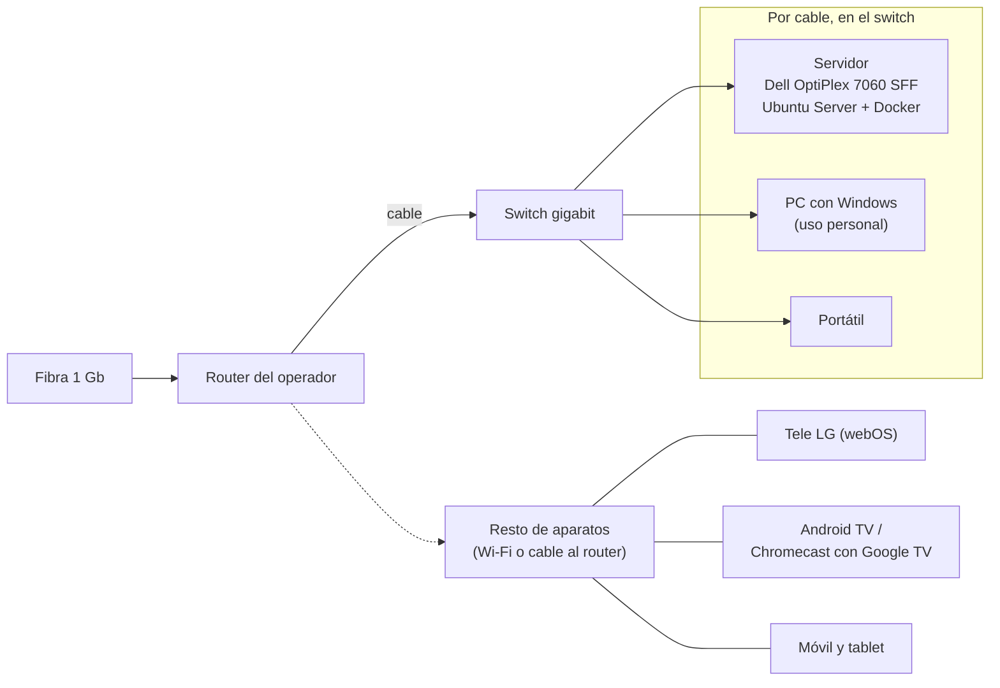
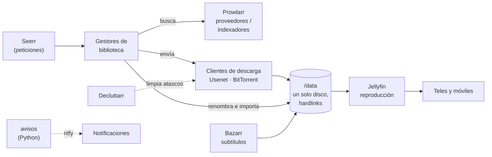
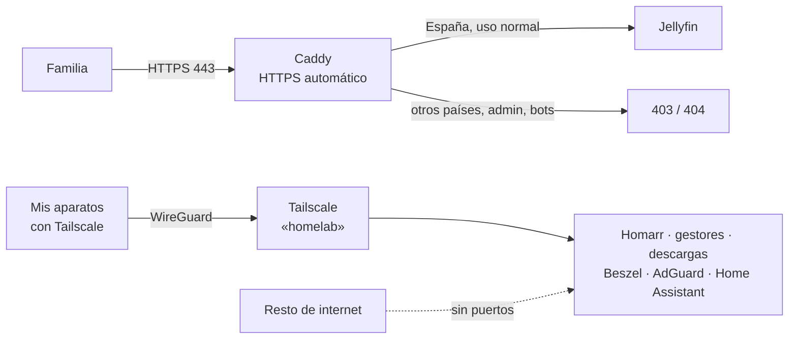
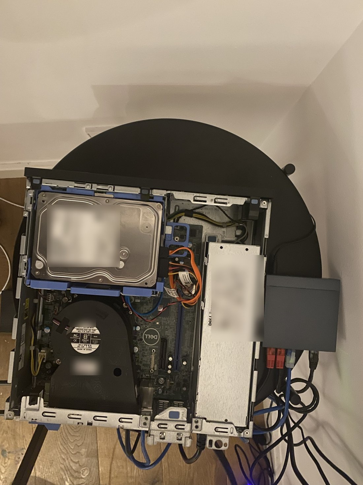
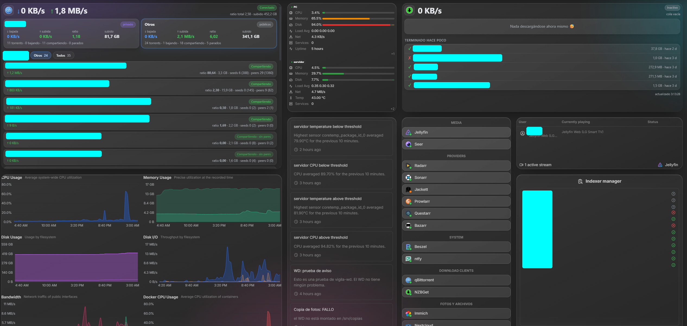
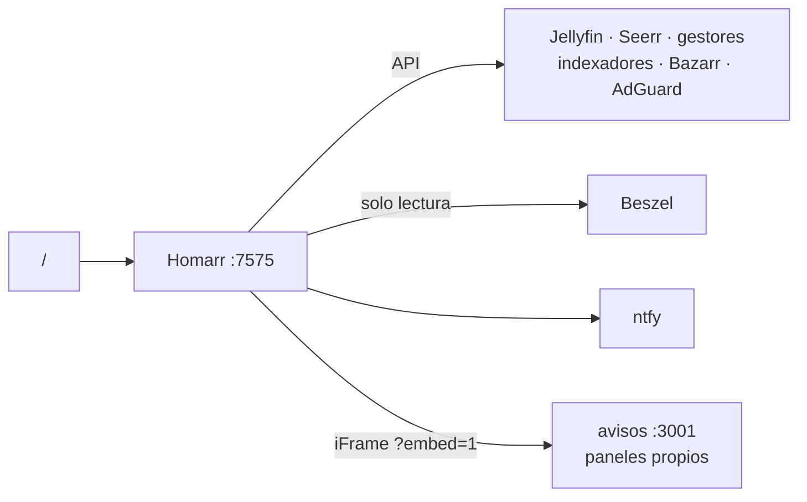

# Mi Homelab


Documentación de mi homelab: un servidor en casa, montado en buena parte con hardware reciclado.

## Por qué lo monté

Estaba harto de que Gmail y Google Drive me avisaran cada dos por tres de que me quedaba sin almacenamiento, y de que HBO Max me metiera anuncios en mitad de las series. Además, tenía varios discos duros de ordenadores antiguos cogiendo polvo y quería darles una segunda vida.

Así que monté mi propio servidor: mis fotos y archivos en casa, mi biblioteca multimedia sin anuncios y, de paso, un sitio donde aprender Linux, Docker, redes y seguridad. Hoy tiene descarga de ISOs automatizada, reproducción multimedia en las teles de casa (y, de forma segura, también fuera), un panel central, monitorización, acceso privado por VPN, DNS con bloqueo de anuncios, domótica con la alarma de casa integrada, fotos y archivos propios y copias de seguridad dentro y fuera de casa.

Empezó como una prueba en Docker Desktop sobre mi PC con Windows y desde el 31 de octubre de 2026 corre en un servidor dedicado: un Dell OptiPlex 7060 SFF de segunda mano con Ubuntu Server y los discos que tenía por casa. La idea es ir mejorándolo poco a poco.

## Estado

| Fase | Qué | Estado |
|---|---|---|
| 0 | Servicios en Docker Desktop (Windows) | ✅ Cumplió su papel; retirada el 30-oct |
| 1 | Servidor dedicado: OptiPlex + Ubuntu Server + Docker | ✅ En marcha desde el 31-oct: discos en su sitio, RAM ampliada a 16 GB y 29 contenedores |
| 2 | NAS, archivos personales y más servicios | Idea |

## Menos hardware, más rendimiento

Sobre el papel, la mudanza fue un *downgrade*: de un Ryzen 5 5600 con 16 GB a un i5-8500 de 2018 con 8 GB. En la práctica, **el homelab rinde mucho mejor y aprovecha cada recurso**, porque el límite nunca fue el procesador, sino la capa de Docker Desktop, un disco SMR y compartir máquina con mi uso diario.

| | PC con Windows | OptiPlex con Ubuntu |
|---|---|---|
| Descargas por Usenet | ~10 MB/s | **84,9 MB/s**, con picos de 771 Mb/s: más de 8 veces más rápido, cerca del máximo de la fibra |
| Transcodificar vídeo | Con el procesador | Con la gráfica integrada (Quick Sync): el procesador, libre |
| Archivos nuevos en Jellyfin | Al siguiente escaneo | Al momento |
| Disponibilidad | Mientras el PC estuviera encendido | 24/7, en una máquina dedicada |
| Recursos | 21 contenedores con el PC al 83 % de RAM | 21 contenedores cabían en 8 GB; hoy **29 contenedores usan solo 4,6 GiB** de los 16 GB a los que amplié la RAM |

> **Y lo mejor no sale en la tabla:** después de una semana con mi ordenador personal encendido día y noche, sufriendo con todos los contenedores a cuestas, por fin lo puedo apagar.

Los porqués, la prueba previa y cómo fue la mudanza: más en [Servidor](docs/08-servidor-nuevo.md#por-qué-no-es-un-paso-atrás).

### Novedades (31 de octubre – 2 de noviembre de 2026)

- **[Servidor asentado](docs/08-servidor-nuevo.md#después-de-la-mudanza-asentar-el-servidor-31-oct):** RAM ampliada a 16 GB y probada, discos en su sitio definitivo, el conflicto de IP de Caddy resuelto y **46,4 GiB recuperados** al volver a unir los hardlinks que perdió la copia.
- **[Copias de seguridad](docs/12-copias-de-seguridad.md):** copia diaria en casa y **copia cifrada fuera de casa** con restic, con acceso mínimo a la nube. Y un disco de copias inestable por USB, ahora vigilado con avisos al móvil.
- **[Fotos y archivos](docs/13-fotos-y-archivos.md):** Immich y Nextcloud, solo por Tailscale y con copia diaria.
- **[Claude Code en el servidor](docs/08-servidor-nuevo.md#claude-code-en-el-servidor)** para administrarlo desde el móvil.
- **[La tele LG que dejó de cargar](docs/02-reproduccion-multimedia.md#la-tele-lg-que-dejó-de-cargar-1-nov)** y el **[panel de descargas que mentía](docs/06-avisos-y-paneles.md#el-panel-de-descargas-que-mentía-31-oct)**, arreglados.

Del 30–31 de octubre: la [mudanza al OptiPlex](docs/08-servidor-nuevo.md#la-mudanza-3031-de-octubre), Quick Sync en Jellyfin, [AdGuard Home](docs/11-dns-adguard-home.md) y Homepage retirado.

El historial completo, con cómo era cada parte antes, está en el [registro de cambios](CHANGELOG.md).

_Última actualización: 2 de noviembre de 2026._

## Índice

- [Arquitectura](#arquitectura)
  - [Red](#red)
  - [Flujo de una petición](#flujo-de-una-petición)
  - [Acceso desde fuera de casa: dos puertas](#acceso-desde-fuera-de-casa-dos-puertas)
- [Hardware](#hardware)
- [Servicios](#servicios)
- [Panel: Homarr](#panel-homarr)
- [Monitorización: Beszel](#monitorización-beszel)
- [Avisos y paneles propios](#avisos-y-paneles-propios)
- [Acceso privado: Tailscale](#acceso-privado-tailscale)
- [DNS: AdGuard Home](#dns-adguard-home)
- [Fotos y archivos](#fotos-y-archivos)
- [Domótica: Home Assistant](#domótica-home-assistant)
- [Seguridad](#seguridad)
- [Copias de seguridad](#copias-de-seguridad)
- [Problemas resueltos](#problemas-resueltos)
- [Próximos pasos](#próximos-pasos)
- [Documentación detallada](#documentación-detallada)

---

## Arquitectura

### Red



| Elemento | Detalle |
|---|---|
| Router | Router del operador, fibra de 1 Gb |
| Red de casa | `192.168.1.0/24`. El servidor, el PC y el portátil van por cable al mismo switch gigabit, así que entre ellos van a velocidad completa aunque internet esté ocupado. El servidor tiene la misma IP fija que antes tenía el PC, y el PC otra IP fija |
| Red interna de Docker | `172.30.0.0/24`, con Caddy en una IP fija para que Jellyfin lo reconozca como proxy |
| Puertos abiertos | Solo el **443** (Jellyfin a través de Caddy) y el puerto de escucha del cliente de descargas. Tailscale no necesita ninguno |
| VPN | Tailscale (WireGuard) con MagicDNS: el servidor es `homelab.<mi-red>.ts.net` |
| DNS | AdGuard Home en el servidor, configurado a mano en cada aparato (el router del operador no deja repartirlo) |
| DNS dinámico | DuckDNS, porque el operador puede cambiar la IP pública |

### Flujo de una petición

Desde el móvil se hace una petición y, sin tocar nada más, el resultado acaba ordenado en la biblioteca y disponible en la tele.



Las descargas y la biblioteca viven bajo una misma carpeta `/data`, así la importación se hace con **hardlinks**: al instante y sin ocupar el doble. Más detalle en [Descarga de ISOs](docs/01-descarga-de-isos.md).

### Acceso desde fuera de casa: dos puertas

- **Pública:** solo Jellyfin, publicado con Caddy y con filtros, para que la familia lo vea sin instalar nada.
- **Privada:** todo lo demás (Homarr, gestores, clientes de descarga, Beszel, AdGuard, Home Assistant…), solo por **Tailscale**, sin abrir ningún puerto más.



Más detalle en [Acceso remoto y seguridad](docs/03-acceso-remoto-y-seguridad.md) y [Acceso privado: Tailscale](docs/09-acceso-privado-tailscale.md).

---

## Hardware

### Servidor (desde el 31-oct)

<p align="center"></p>

| Componente | Especificación |
|---|---|
| Equipo | Dell OptiPlex 7060 SFF, de segunda mano |
| CPU | Intel Core i5-8500 (6 núcleos) con gráfica UHD 630 → **Quick Sync** para transcodificar en Jellyfin |
| RAM | 16 GB DDR4-2400 en doble canal (ampliada el 31-oct desde 8 GB; 4 ranuras, hasta 64 GB) |
| Sistema | SSD SATA 500 GB (Crucial MX500): sistema, configuraciones y carpeta temporal de descargas |
| Datos | HDD 1 TB CMR (Toshiba DT01ACA100) por SATA: biblioteca, descargas, fotos y archivos (396 GB usados de 916) |
| Copias | HDD 1 TB (WD WD10EZEX) por USB: copia diaria de configuraciones, fotos y archivos |
| Red | Gigabit por cable al switch |
| Sistema operativo | Ubuntu Server 26.04.1 LTS + Docker |

Antes de usarlos, revisé la salud de los tres discos con SMART y repartí los papeles según el resultado: el disco con el historial más dudoso es el de copias, para que si falla solo se pierda la copia y no la biblioteca. Detalle en [Servidor](docs/08-servidor-nuevo.md).

### Servidor anterior: mi PC (hasta el 30-oct)

| Componente | Especificación |
|---|---|
| Equipo | PC de sobremesa con Windows, también de uso diario |
| CPU | AMD Ryzen 5 5600 (6 núcleos / 12 hilos) |
| RAM | 16 GB |
| Datos | HDD de 2 TB (SMR) con la biblioteca y las descargas |
| Contenedores | Docker Desktop sobre WSL2 |

### Aparatos que lo usan

| Aparato | Uso |
|---|---|
| Tele LG (webOS, modelo antiguo) | App de Jellyfin de LG Content Store |
| Android TV / Chromecast con Google TV | App nativa de Jellyfin |
| PC, iPhone e iPad | Jellyfin en navegador o app; Homarr como página de inicio; AdGuard como DNS |
| Móvil | Tailscale siempre activo; Seerr y Homarr en la pantalla de inicio |

---

## Servicios

Todo corre en contenedores con Docker Compose, salvo Tailscale, que va instalado en el sistema. Lo que pone "Casa" se usa también desde fuera **por Tailscale**.

| Área | Servicio | Para qué | Acceso |
|---|---|---|---|
| Reproducción multimedia | **Jellyfin** | Streaming a teles y móviles, con transcodificación por hardware | Casa + internet (vía Caddy) |
| | **Bazarr** | Subtítulos automáticos y sincronizados con el vídeo | Casa |
| Descarga de ISOs | **Seerr** | Peticiones desde el móvil | Casa |
| | **Sonarr / Radarr** | Gestores de biblioteca: deciden qué descargar, renombran e importan | Casa |
| | **Questarr** | Gestor de biblioteca para juegos | Casa |
| | **Prowlarr** (+ Jackett y FlareSolverr) | Proveedores / indexadores | Casa |
| | **NZBGet · qBittorrent** | Clientes de descarga (Usenet y BitTorrent) | Casa |
| | **Decluttarr** | Limpia descargas atascadas o fallidas | Solo interno |
| Panel y monitorización | **Homarr** | Panel principal (Homepage, el anterior, retirado el 31-oct) | Casa |
| | **Beszel** | Monitorización de recursos y alertas, del servidor y del PC | Casa |
| | **avisos** (propio) | Notificaciones por ntfy, página "Actividad" y paneles de descargas | Casa |
| Red | **AdGuard Home** | DNS con bloqueo de anuncios y rastreadores, DoH hacia fuera | Casa |
| Personal | **Immich** | Fotos, con subida automática desde el móvil | Solo Tailscale |
| | **Nextcloud** | Archivos | Solo Tailscale |
| Copias | **restic + rclone** | Copia cifrada fuera de casa | — |
| Domótica | **Home Assistant** | Alarma de casa (estado, armado, fotos, historial) | Casa, nunca publicado |
| Acceso remoto | **Caddy** | Proxy inverso con HTTPS automático; publica solo Jellyfin | Internet (443) |
| | **DuckDNS** | Mantiene el dominio apuntando a la IP de casa | Solo interno |
| | **Tailscale** | VPN para todo lo demás; instalado en el sistema, no en Docker | Mis aparatos |

### Reproducción multimedia

<!-- 📸 Captura de la pantalla de inicio con el tema: images/jellyfin-inicio.png -->

Jellyfin con aspecto de plataforma de streaming: carrusel de portada (**Media Bar**), etiquetas de calidad e idioma en los pósters (**Jellyfin Enhanced**), botón para **saltar intros y créditos** (**Intro Skipper**) y el tema **Jellyfish**. Antes de activarlo en todas partes comprobé qué funciona en cada aparato, incluida una tele LG antigua (a la que hubo que quitarle un plugin el 1-nov). Tiene también **TV en directo** con guía de programación y, desde la mudanza, **transcodificación por hardware con Quick Sync**. Más en [Reproducción multimedia](docs/02-reproduccion-multimedia.md).

### Subtítulos

Bazarr descarga los subtítulos y los **sincroniza solos** con ffsubsync, usando como referencia los subtítulos incrustados del vídeo o el audio. Un script en PowerShell aplica los ajustes y resincroniza en lote los que ya había, guardando una copia de los originales. Más en [Subtítulos con Bazarr](docs/04-subtitulos-bazarr.md).

---

## Panel: Homarr



Desde el 26 de octubre, **Homarr v2** es la página de inicio del homelab, y desde el 31 el único panel: **Homepage**, que se configuraba con archivos YAML, quedó retirado tras la mudanza. Homarr se configura desde la propia web, guarda las credenciales cifradas y permite un diseño distinto para PC y para móvil.

- **Integraciones por nombre de contenedor** (`http://jellyfin:8096`…): sobrevivieron a la mudanza sin tocar nada. Las pocas que usan la IP del servidor necesitaron abrir el cortafuegos a las redes de Docker.
- **Tablero** con tema "aurora / glass" y CSS propio para que todo, incluidos widgets de la comunidad, tenga el mismo estilo de cristal translúcido.
- **Paneles de descargas hechos a medida** (Python) y metidos como iFrame, con fondo transparente y refresco cada 3 s, porque los widgets de serie se quedaban cortos.
- **Estado de todo de un vistazo:** máquinas (Beszel), DNS (AdGuard), notificaciones, indexadores, reproducciones en curso y botones de todas las apps con su punto de estado.
- **Útil para mantener:** el widget de indexadores destapó duplicados y fallos que ralentizaban las búsquedas.



Despliegue, integraciones, diseño del tablero, CSS, paneles propios y lo que aprendí por el camino: más en [Panel principal: Homarr](docs/05-panel-homarr.md).

## Monitorización: Beszel

**Beszel** mide CPU, RAM, red, temperatura, discos (con **SMART**) y **cada contenedor por separado**, guarda historial y avisa al móvil por ntfy. Se mudó al servidor con su historial: ahora vigila el **servidor** con su propio agente y el **PC** con un agente nativo de Windows, que solo acepta conexiones del servidor. Más en [Monitorización: Beszel](docs/07-monitorizacion-beszel.md).

## Avisos y paneles propios

Un servicio **en Python sin dependencias** envía notificaciones al móvil por **ntfy** (lo añadido, lo fallido y alertas de seguridad de Jellyfin), sirve una página **"Actividad"** con el motivo de cada fallo explicado en castellano y genera los **paneles de descargas** de Homarr. Más en [Avisos y paneles propios](docs/06-avisos-y-paneles.md).

## Acceso privado: Tailscale

Desde el 29 de octubre, todo menos Jellyfin se usa desde fuera de casa por **Tailscale**:

- **Instalado en el sistema**, no en Docker ni con un nodo por app: una sola máquina, `homelab`, da acceso a todos los puertos. Sin HTTPS de Tailscale, porque WireGuard ya cifra el tráfico.
- **Mudanza transparente:** el PC pasó a llamarse `pc` y el servidor tomó el nombre `homelab`, así que **ningún enlace cambió**. En el servidor, además, **Tailscale SSH**.
- **Cortafuegos** que solo admite el rango de Tailscale para el acceso remoto.

Más en [Acceso privado: Tailscale](docs/09-acceso-privado-tailscale.md).

## DNS: AdGuard Home

Desde el 31 de octubre, el servidor es también el **DNS** de mis aparatos: bloquea anuncios, rastreadores y dominios maliciosos con la lista **HaGeZi Pro** y resuelve hacia fuera **cifrado** (DoH con Quad9 y Cloudflare). Escucha solo en la IP de casa del servidor, para convivir con el DNS del propio Ubuntu y con Tailscale. El router del operador no permite repartirlo por DHCP, así que de momento se configura aparato por aparato; para toda la casa hará falta un router propio. Más en [DNS: AdGuard Home](docs/11-dns-adguard-home.md).

## Domótica: Home Assistant

**Home Assistant** integra la **alarma de casa** (Verisure / Securitas Direct) con la integración comunitaria **Verisure OWA** (HACS), porque la oficial habla con otra plataforma que no sirve en España: armar y desarmar, fotos de las cámaras bajo demanda, temperatura y humedad, e historial de quién hizo qué. En el servidor va en la red del host, para poder descubrir los aparatos de casa.

Como desde ahí se puede desarmar la alarma, lo trato como la propia alarma: **usuario de Verisure propio** para Home Assistant, contraseña única y **verificación en dos pasos**, y **nunca publicado en internet**, solo por Tailscale. Más en [Domótica: Home Assistant](docs/10-domotica-home-assistant.md).

---

## Seguridad

- **Solo Jellyfin está expuesto.** El resto de servicios solo es accesible desde casa o por **Tailscale**, sin abrir más puertos.
- **Caddy** como única puerta de entrada: HTTPS automático, solo conexiones desde **España** (4.326 rangos de IP, actualizados cada mes), rutas de administración de Jellyfin bloqueadas desde fuera, rutas típicas de bots (`.php`, `/wp-admin`, `/.env`…) cortadas con 404 y cabeceras de seguridad (HSTS, `nosniff`). En el servidor, Caddy ya ve la IP real de cada visita.
- **Usuarios de Jellyfin:** el administrador no puede entrar desde internet, todos los usuarios están ocultos en la pantalla de inicio de sesión y el usuario externo tiene permisos mínimos y bloqueo tras 5 intentos fallidos.
- **Alertas al móvil:** intentos de acceso fallidos, usuarios bloqueados, **dispositivos nuevos** y cambios de usuarios o contraseñas.
- **Contraseñas únicas y aleatorias en KeePassXC** para todos los servicios, renovadas otra vez tras la mudanza.
- **Cortafuegos `ufw`** en el servidor: solo la red de casa, Tailscale y las redes internas de Docker.
- **Fotos y archivos solo por Tailscale**, y **copia cifrada fuera de casa** con acceso mínimo a la nube.
- **Claude Code en el servidor** sin permiso para leer los archivos de secretos, y sus comandos revisados antes de aprobarlos.
- **Home Assistant** con 2FA y nunca publicado, porque desde él se puede desarmar la alarma.
- **Plan de seguridad por fases:** pendientes CrowdSec y docker-socket-proxy y, más adelante, una red separada para IoT, cámaras e invitados. Más en [Plan](docs/03-acceso-remoto-y-seguridad.md#plan-de-seguridad-por-fases).
- **Secretos fuera del compose**, en archivos `.env`. Homarr guarda las credenciales de sus integraciones **cifradas**, y tanto Homarr como Beszel usan **usuarios de solo lectura** donde es posible.

> **Lo que descubrí:** con Caddy dentro de Docker en Windows, todo lo que llegaba de internet parecía venir de la red de casa, y Jellyfin permite algunas acciones (como reiniciar o apagar el servidor) a cualquiera que esté "en casa". Lo corregí bloqueando esas rutas en Caddy, definiendo bien las redes de Jellyfin y, después, sacando Caddy de Docker para ver la IP real. En el servidor nuevo, Linux conserva la IP real y Caddy ha vuelto a su contenedor. Más en [Acceso remoto y seguridad](docs/03-acceso-remoto-y-seguridad.md).

---

## Fotos y archivos

Desde el 1 de noviembre, **Immich** (fotos, con subida automática desde el móvil) y **Nextcloud** (archivos), los dos **solo por Tailscale**. Los datos van al disco grande y las bases de datos al SSD, fuera de los volúmenes de Docker para no inflar la copia diaria. Más en [Fotos y archivos](docs/13-fotos-y-archivos.md).

---

## Copias de seguridad

| Qué | En casa (disco de copias) | Fuera de casa (cifrada) |
|---|---|---|
| Configuraciones | ✅ Diaria, 14 días (~308 MB) | ✅ restic, 7 diarias + 4 semanales, verificación semanal |
| Fotos y archivos | ✅ Diaria, con volcado de bases de datos | Con el NAS futuro |
| Biblioteca multimedia | ❌ Se puede volver a descargar | ❌ |

- **Un RAID no es una copia:** no protege de un borrado, de un error de un programa o de un ransomware. Por eso, copias con historial.
- **Mínimo privilegio:** la herramienta de copia solo ve en la nube los archivos que crea ella.
- **La mudanza fue la mejor prueba:** las 17 configuraciones exportadas en Windows se restauraron en el servidor sin un solo fallo.
- **Un disco de copias inestable:** se desconecta por USB de vez en cuando. Ahora un temporizador lo vigila cada minuto y avisa al móvil, y las copias no se ejecutan si no está montado, para no escribir en el disco equivocado.

Más en [Copias de seguridad](docs/12-copias-de-seguridad.md).

---

## Problemas resueltos

Una selección; la lista completa, con síntoma, causa y solución, está en [Problemas resueltos](docs/14-problemas-resueltos.md).

| Problema | Causa | Solución |
|---|---|---|
| Usenet a solo ~10 MB/s | Escritura en un HDD SMR a través de Docker Desktop | ✅ En el servidor, temporal en SSD y disco CMR: **84,9 MB/s** |
| Disco C: casi lleno | El disco virtual de Docker (WSL2) había crecido a 61 GB | Limpieza, `fstrim` y compactado con `diskpart`: ~54 GB recuperados |
| Descargas casi completas que acababan borradas | Fallo en la extensión *Completion* de NZBGet: revisaba el NZB equivocado y castigaba a otro | Parche de ~6 líneas en su `main.py` |
| Avisos de qBittorrent que dejaron de llegar | qBittorrent 5.2 cambió la respuesta de su inicio de sesión | Aceptar el 204, cookie a mano y espera tras un fallo para no autobloquearse |
| Jellyfin trataba internet como red local | NAT de Docker en Windows | Filtros en Caddy, redes de Jellyfin y Caddy fuera de Docker |
| Notificaciones de Homarr con `ETIMEDOUT` | Node da 250 ms por intento de conexión y WSL2 añade latencia | `--network-family-autoselection-attempt-timeout=2000` |
| *Connect Timeout* entre contenedores en el servidor | El cortafuegos no dejaba pasar las redes de Docker | `ufw allow from 172.16.0.0/12`, también en el script de instalación |
| Ubuntu solo usaba ~100 GB del SSD | LVM marcado por defecto en el instalador | Desmarcarlo al instalar |
| ~50 GB duplicados tras copiar la biblioteca | `robocopy` no conserva los hardlinks | `jdupes`, probado antes en una carpeta temporal: 46,4 GiB recuperados |
| Caddy no arrancaba tras un reinicio | Su IP fija estaba dentro del rango automático de Docker | Separar el rango automático de las IPs fijas |
| La tele LG no cargaba Jellyfin | Un plugin de la pantalla de inicio | Retirarlo, cambiando una sola cosa cada vez |
| La copia en la nube no podía autorizarse | OAuth necesita navegador y el servidor no tiene | Completar el flujo a mano con `curl` |
| "Parado", pero seguía en marcha | Script lanzado sin administrador que informaba mal | Pararlo a mano y comprobar cada paso, no el mensaje |
| La integración oficial de Verisure no inicia sesión | Habla con MyPages; las cuentas de España están en OWA | Integración comunitaria Verisure OWA |
| SMART idéntico en dos discos distintos | El adaptador USB mezclaba los datos con dos discos a la vez | Revisarlos de uno en uno |

---

## Próximos pasos

- [x] **Mudanza al OptiPlex**, Quick Sync, AdGuard Home y Homepage retirado (31-oct).
- [x] **RAM a 16 GB**, discos en su sitio y hardlinks recuperados (31-oct).
- [x] **Copia cifrada fuera de casa** de las configuraciones (1-nov).
- [x] **Fotos y archivos** con Immich y Nextcloud (1-nov).
- [ ] **Resolver los cortes USB** del disco de copias.
- [ ] **Comprobar las primeras copias automáticas** de fotos, archivos y la copia cifrada, y hacer una restauración de prueba.
- [ ] **Avisos de seguridad de Jellyfin:** su clave de API da error 401.
- [ ] **Refresco de los canales de TV en directo**, que está fallando.
- [ ] **Ampliar el almacenamiento** en el Black Friday, y la copia fuera de casa de fotos y archivos.
- [ ] **Seguridad, fase 1:** CrowdSec en Caddy y docker-socket-proxy.
- [ ] **Desinstalar Docker Desktop del PC** tras una semana estable.
- [ ] **Versionar la configuración en git** (compose, Caddyfile, scripts), sin claves.
- [ ] **Homarr:** diseño para móvil, calendario y peticiones, e integración con Home Assistant.
- [ ] **Home Assistant:** app en el móvil y automatizaciones.
- [ ] **Router propio** para repartir AdGuard a toda la casa y separar la red.

---

## Documentación detallada

| Página | Contenido |
|---|---|
| [01 · Descarga de ISOs](docs/01-descarga-de-isos.md) | Gestores de biblioteca, indexadores, clientes de descarga, carpetas y Decluttarr |
| [02 · Reproducción multimedia](docs/02-reproduccion-multimedia.md) | Jellyfin: plugins, tema, compatibilidad con cada aparato, TV en directo y Quick Sync |
| [03 · Acceso remoto y seguridad](docs/03-acceso-remoto-y-seguridad.md) | Caddy, DuckDNS, filtro por país, alertas, contraseñas y plan de seguridad por fases |
| [04 · Subtítulos con Bazarr](docs/04-subtitulos-bazarr.md) | Sincronización automática y script en lote |
| [05 · Panel principal: Homarr](docs/05-panel-homarr.md) | Despliegue, integraciones, tablero, tema, paneles propios y cómo era antes con Homepage |
| [06 · Avisos y paneles propios](docs/06-avisos-y-paneles.md) | Servicio en Python: ntfy, página Actividad y paneles de descargas |
| [07 · Monitorización: Beszel](docs/07-monitorizacion-beszel.md) | Hub, agentes, alertas, integraciones y su mudanza al servidor |
| [08 · Servidor](docs/08-servidor-nuevo.md) | Por qué no es un paso atrás (con resultados medidos), la mudanza paso a paso, RAM, hardlinks, Claude Code, discos y kit de mudanza |
| [09 · Acceso privado: Tailscale](docs/09-acceso-privado-tailscale.md) | Todo menos Jellyfin por VPN, scripts y cómo pasó el nombre al servidor |
| [10 · Domótica: Home Assistant](docs/10-domotica-home-assistant.md) | Alarma de casa con Verisure OWA, limitaciones y seguridad |
| [11 · DNS: AdGuard Home](docs/11-dns-adguard-home.md) | Despliegue junto al DNS de Ubuntu, DoH, listas y el problema del router del operador |
| [12 · Copias de seguridad](docs/12-copias-de-seguridad.md) | Copia local, copia cifrada fuera de casa y el disco de copias inestable |
| [13 · Fotos y archivos](docs/13-fotos-y-archivos.md) | Immich y Nextcloud: diseño del almacenamiento y copias |
| [14 · Problemas resueltos](docs/14-problemas-resueltos.md) | Registro de fallos: síntoma, causa y solución |
| [Registro de cambios](CHANGELOG.md) | Evolución del homelab y cómo era cada parte antes |

## Estructura del repositorio

```
.
├── README.md
├── CHANGELOG.md   ← evolución y versiones anteriores
├── docs/          ← documentación detallada por tema
└── images/        ← capturas de pantalla (ver images/README.md)
```
