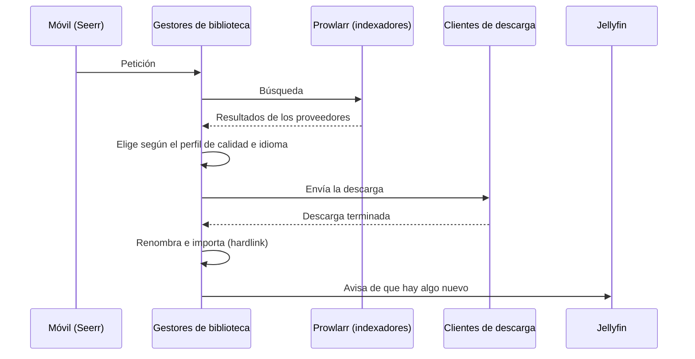

# 📥 Descarga de ISOs y biblioteca

[← Volver al README](../README.md)

La parte del homelab que recibe una petición, la busca en los proveedores, la descarga y la deja ordenada en la biblioteca, sin intervención manual.

## Cómo funciona



| Pieza | Papel |
|---|---|
| **Seerr** | Interfaz para hacer peticiones desde el móvil, con el usuario de Jellyfin |
| **Sonarr / Radarr** | Gestores de biblioteca: deciden qué descargar según el perfil, lo mandan al cliente y, al terminar, lo renombran y lo importan |
| **Prowlarr** | Gestor central de proveedores / indexadores; los reparte a los gestores de biblioteca |
| **Jackett, FlareSolverr** | Auxiliares de Prowlarr para algunos indexadores |
| **NZBGet** | Cliente de descarga por Usenet |
| **qBittorrent** | Cliente de descarga por BitTorrent |
| **Decluttarr** | Limpia descargas atascadas, lentas o fallidas |

## Estructura de carpetas

Las descargas y la biblioteca están en **un mismo disco y una misma carpeta**, montada como `/data` en todos los contenedores:

```
/data
├── media/      ← biblioteca de Jellyfin
├── torrents/   ← descargas de qBittorrent
└── usenet/     ← descargas de NZBGet
```

Así, al importar, los gestores de biblioteca crean un **hardlink** en lugar de copiar: es instantáneo y el archivo no ocupa el doble.

| | Windows (hasta el 30-oct) | Ubuntu (desde el 31-oct) |
|---|---|---|
| Carpeta real | `J:\homelab\data` | `/srv/data` (disco de datos) |
| Dentro de los contenedores | `/data` | `/data` |

Como dentro de los contenedores la ruta no cambia, en la mudanza **no hay que reconfigurar ninguna aplicación**.

## Docker Compose

- Un `docker-compose.yml` con la pila principal y un `docker-compose.override.yml` con los extras (panel, avisos, monitorización, acceso remoto). Docker los une solo.
- Variables comunes definidas una sola vez con un **ancla YAML** (`&entorno`) y reutilizadas en cada servicio.
- La carpeta de datos se monta como `${DATA_DIR:-/srv/data}:/data`, así el mismo archivo sirve en Windows y en Linux.
- La configuración de cada aplicación va en **volúmenes con nombre**, fáciles de exportar y restaurar.
- Las contraseñas y claves van en archivos `.env`, fuera del compose.

## Perfiles

Los gestores de biblioteca usan **perfiles de calidad e idioma** con puntuaciones, para priorizar el audio en castellano y la calidad que quiero sin tener que elegir a mano cada vez.

## NZBGet

- **Rutas:** la imagen de LinuxServer apunta por defecto a `/downloads`, que no existe en un montaje basado en `/data`. Hay que cambiar `MainDir` a `/data/usenet` y dejar el resto de rutas con `${MainDir}`; si no, salen errores de *Permission denied*.
- **Reparación:** búfer de reparación (`ParBuffer`) a 500 MB.
- **Extensión *Completion*:** antes de descargar, comprueba que el archivo esté completo en el servidor. Si faltan demasiadas partes, lo descarta y el gestor de biblioteca busca otra opción en segundos. Encontré y corregí un fallo en ella (ver abajo).
- **Velocidad:** en Windows iba a unos 10 MB/s, limitada por la escritura en el HDD SMR a través de Docker Desktop. En el servidor, con la carpeta temporal en el SSD, la primera descarga fue a **84,9 MB/s** (≈680 Mbps). Ver [Servidor](08-servidor-nuevo.md#los-resultados).
- **Caché de artículos** a 500 MB, ajustada a los 8 GB de RAM del servidor.

### El fallo de la extensión *Completion*

**Síntoma:** una descarga casi completa (le faltaba un 0,2 %, reparable de sobra) acabó marcada como fallida y borrada.

**Causa:** la extensión se dispara con distintos avisos de NZBGet ("se ha añadido un NZB", "se ha borrado un NZB"…). Al procesar la cola, en vez de revisar el archivo NZB de cada elemento, revisaba siempre el del NZB que había provocado el aviso. Así, al borrarse otra descarga que sí estaba rota, comprobó ese archivo (38 % de partes perdidas) y castigó al siguiente de la cola quitándole sus archivos de reparación (par2). Sin ellos, NZBGet no pudo reconstruir los pocos trozos que faltaban.

**Solución:** un cambio de unas 6 líneas en `main.py` de la extensión: para cada NZB de la cola usa el nombre de su propio archivo, que la extensión ya guarda al añadirlo, y solo si no lo encuentra recurre al del aviso.

## qBittorrent

- **Ruta de guardado:** la imagen de LinuxServer también usa `/downloads` por defecto; hay que cambiarla a `/data/torrents`.
- **Conectividad:** puerto de escucha redirigido en el router y permitido en el firewall de Windows.
- **Versión fijada:** con qBittorrent 5.2.4 la web se colgaba, así que la imagen está fijada a la versión anterior en el compose.
- **qBittorrent 5.2** cambió la respuesta de su API de inicio de sesión, y eso rompió los avisos del homelab. Ver [Avisos y paneles propios](06-avisos-y-paneles.md#arreglos-del-26-de-octubre).

## Decluttarr

- Lo arranqué primero en **modo prueba** (`test_run`), que solo anota lo que haría, y revisé el log antes de activarlo.
- Desactivé dos reglas después de diagnosticar con los logs que borraban descargas legítimas:
  - `remove_orphans`: borraba las descargas lanzadas a mano desde Prowlarr, porque el gestor de biblioteca no las reconocía como suyas.
  - `remove_unmonitored`: borraba descargas de elementos que no estaban marcados como seguidos.
- Cada cambio en `config.yaml` deja una copia `.bak` con fecha.

## Indexadores

El 27 de octubre los reorganicé gracias al widget de estado de Homarr, que dejó a la vista indexadores **dados de alta dos veces** (en Prowlarr y en Jackett) y otros que **fallaban en cada búsqueda** y solo la ralentizaban. Ahora cada indexador está en un solo sitio, directamente en Prowlarr siempre que lo soporta.
