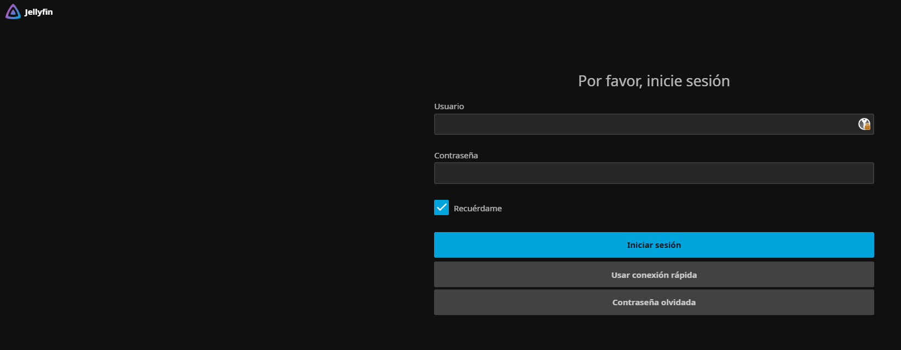

# Reproducción multimedia: Jellyfin

[← Volver al README](../README.md)

Jellyfin 12.2 (imagen de LinuxServer). La idea era que se pareciera a una plataforma de streaming y que se pudieran saltar las intros, sin romper nada en las teles.

Los usuarios no aparecen en la pantalla de inicio de sesión: hay que escribir el nombre (ver [Seguridad](03-acceso-remoto-y-seguridad.md#jellyfin)).

## Plugins

Todo se instaló desde *Panel → Plugins → Catálogo*, añadiendo antes estos repositorios, así que se actualiza solo desde ahí:

- Intro Skipper: `https://intro-skipper.org/manifest.json`
- IAmParadox27: `https://www.iamparadox.dev/jellyfin/plugins/manifest.json`
- n00bcodr: `https://raw.githubusercontent.com/n00bcodr/jellyfin-plugins/main/manifest.json`

| Plugin | Para qué |
|---|---|
| **Intro Skipper** | Detecta intro, créditos, resumen y avance, y muestra un botón "Saltar". Analiza lo nuevo cada noche a las 00:00 |
| **Media Bar** | Carrusel grande de portada |
| ~~**Home Screen Sections**~~ | Filas de inicio modulares con "Próximamente". **Retirado el 1-nov:** impedía cargar la app de la tele LG (ver abajo) |
| **Jellyfin Enhanced** | Etiquetas de calidad e idioma en los pósters, pantalla de pausa, botón aleatorio y selector de colores. Analíticas desactivadas |
| File Transformation, Plugin Pages | Dependencias de los anteriores |

**Primer análisis de Intro Skipper:** 1 h 36 min para 97 episodios; detectó segmentos en 94 (70 intros y 84 créditos). Los 3 restantes eran de una temporada con solo 3 episodios, demasiado pocos para comparar.

## Tema

En *Panel → General → CSS personalizado* está el tema **Jellyfish** (`theme.css`, `indicators.css`, `progress_bar.css`), activo en todos los navegadores, también en las teles.

La excepción es `slideshow.css`, que solo da estilo al carrusel. Lo cargo con la condición `(width >= 0px)`, que solo entienden los navegadores modernos (Chrome/Edge 104+, Safari 16.4+, LG webOS 24+). En una tele antigua el carrusel no se carga, y sin esa condición su CSS dejaría un hueco enorme encima de las filas de inicio.

## Compatibilidad con cada aparato

Antes de activarlo todo, comprobé qué funciona en cada aparato:

| Aparato | Tema | Carrusel y Enhanced | Filas de inicio | Saltar intro |
|---|---|---|---|---|
| PC, iPhone (web y app) | ✅ | ✅ | ✅ | ✅ |
| LG webOS 24+ (2024 o más nueva) | ✅ (algún detalle de color puede faltar) | ✅ | ✅ | ✅ |
| LG webOS 22/23 | ✅, puede verse incompleto (sin `:has()`) | ✅ | ✅ | ✅ |
| LG anterior a 2022 | ✅, puede verse incompleto (motor antiguo) | ❌ su JavaScript es demasiado moderno; no rompe nada | ✅ | ✅ |
| Android TV (app nativa) | ❌ la app nativa no usa la web | ❌ | ❌ | ✅ usa los segmentos de Intro Skipper |

**Cómo lo comprobé:**

- Pasé los **864 archivos de la web de Jellyfin**, incluidos los modificados por los plugins, por un analizador de JavaScript en modo **ES2016**, que es lo que entiende el navegador de una LG de 2018-2019. Todos se leen sin errores.
- **Media Bar** y **Jellyfin Enhanced** usan sintaxis de ES2020 (`?.`), así que en las teles viejas simplemente no se cargan.
- El CSS de Media Bar bajaba las filas de inicio un 65 % aunque su script no llegara a cargarse. Por eso el CSS personalizado pone ese margen a 0 y solo lo devuelve en navegadores modernos.

**Plan B si una tele se ve rara:**

1. Solo en esa tele: *Ajustes → Pantalla → desactivar el CSS personalizado del servidor*.
2. Para todas las teles antiguas: añadir `(width >= 0px)` al final de cada `@import`, y se quedan con el aspecto normal de Jellyfin.

Antes de tocar nada, guardé la configuración anterior de plugins y de apariencia en dos JSON.

## TV en directo

Añadida el 28 de octubre con un plugin que añade a Jellyfin un **sintonizador nativo** con **guía de programación (EPG)**. Así los canales salen en *TV en directo → Guía / Canales* en todos los aparatos, también en la app nativa de Android TV.

- **Compatibilidad:** el primer plugin que encontré tenía su última versión para Jellyfin 10.11 y no funcionaba en la 12.2. Elegí una alternativa mantenida y ya publicada para la 12, instalada desde su repositorio en el catálogo de plugins.
- **Solo TV en directo:** la sincronización de catálogos bajo demanda está apagada, para no llenar el disco de archivos `.strm` ni gastar RAM, y solo están activas las categorías de canales que uso, para que la guía no vaya lenta.
- **Seguridad:** la opción de publicar listas de reproducción está **apagada**, porque sus URL llevan las credenciales del proveedor y Jellyfin está abierto a internet.
- **Permisos:** cada usuario necesita "Permitir acceso a TV en directo".
- **Intro Skipper:** hay que excluir este contenido, para que no intente analizar emisiones cada noche.

## Pendiente

- Averiguar la versión de webOS de la tele del salón.
- Conectar Seerr en Jellyfin Enhanced, para hacer peticiones desde el propio buscador de Jellyfin.
- Revisar el refresco de los canales de TV en directo, que está fallando.
- Clave de TMDB para la función "Elsewhere" (en qué plataforma está cada título).
- Saltar intros automáticamente (*Jellyfin Enhanced → Playback → Auto Skip Intro*).
- ~~En el servidor nuevo: transcodificación por hardware con Intel Quick Sync~~ ✅ Hecho el 31-oct (ver abajo).

## En el servidor nuevo (31-oct)

- **Transcodificación por hardware con Intel Quick Sync** (QSV, driver `iHD`) y **tone mapping** (para ver contenido HDR en pantallas SDR), sin AV1 ni modo de bajo consumo, que la UHD 630 no soporta. Comprobado con `intel_gpu_top`: forzando una calidad baja (menos de 3 Mbps) para obligar a transcodificar, el motor de vídeo de la gráfica se pone al ~34 % y el de render al ~31 %, con el procesador libre. Por encima de ese bitrate, el navegador del PC reproduce directamente y la gráfica se queda a 0 %, que es lo normal.
- **Redes:** Caddy como proxy conocido (su IP fija en la red de Docker) y como red local solo la de casa. Fuera la IP interna de Docker Desktop que hacía falta en Windows.
- **Archivos nuevos al momento:** en Linux, Jellyfin se entera de lo que llega a la biblioteca sin esperar al escaneo.
- **Administrador sin acceso remoto**, comprobado desde fuera de casa.

## La tele LG que dejó de cargar (1-nov)

- **Síntoma:** la app de Jellyfin de la tele LG no cargaba.
- **Qué se probó:** primero quitar el CSS del tema, que no bastó (o no se llegó a comprobar por separado); después, retirar el plugin **Home Screen Sections**, que además daba un error en el servidor.
- **Resultado:** sin el plugin, la tele funciona. La configuración quedó guardada para poder revertirlo.
- **Aprendido:** lo que se comprobó antes con un analizador de JavaScript (que el código *se lee* en un navegador antiguo) no garantiza que todo *funcione* en la tele real. Hay que probar en el aparato, y cambiar una sola cosa cada vez para saber cuál era la culpable.

