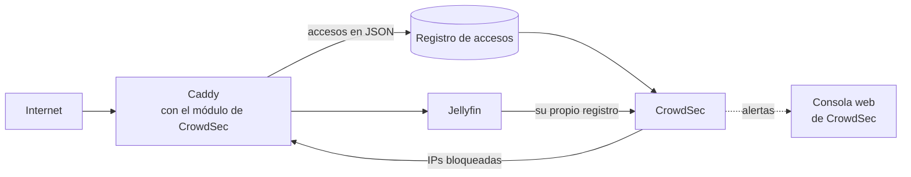
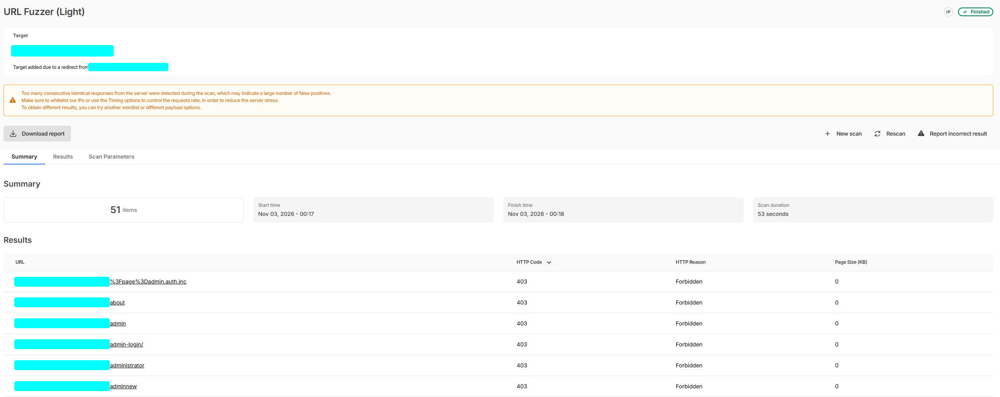
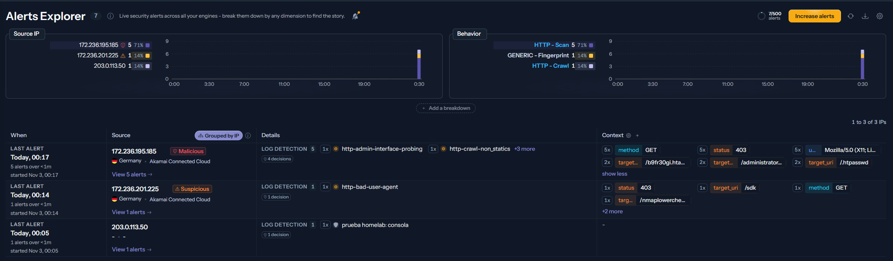

# Acceso remoto y seguridad

[← Volver al README](../README.md)

**Objetivo:** ver Jellyfin fuera de casa (también desde la casa de un familiar) sin exponer nada más a internet.

El homelab tiene dos puertas:

- **Pública**, la de esta página: solo Jellyfin, a través de Caddy y con filtros.
- **Privada**, para todo lo demás: [Tailscale](09-acceso-privado-tailscale.md), sin abrir ningún puerto más (desde el 29-oct).

Más abajo están [CrowdSec](#crowdsec-bloqueo-automático-2-nov), que bloquea automáticamente las IPs que atacan, el [socket de Docker en solo lectura](#el-socket-de-docker-en-solo-lectura-2-nov), la [gestión de contraseñas](#contraseñas-keepassxc) y el [plan de seguridad por fases](#plan-de-seguridad-por-fases).

## Piezas

| Pieza | Papel |
|---|---|
| **DuckDNS** | Contenedor que mantiene un subdominio gratuito apuntando a la IP de casa, que el operador puede cambiar |
| **Router** | Solo redirige el puerto **443** hacia Caddy (y el de escucha del cliente de descargas). Nada de 8096, 8989, etc. |
| **Caddy** | Única puerta de entrada: HTTPS automático, filtros y proxy inverso hacia Jellyfin |
| **CrowdSec** | Lee los registros de Caddy y de Jellyfin y bloquea en Caddy las IPs que atacan (desde el 2-nov) |

## Lo que descubrí: internet parecía la red de casa

En la primera versión, Caddy corría dentro de Docker Desktop. En Windows, Docker hace NAT, así que **todo lo que llegaba de internet le llegaba a Jellyfin desde la IP interna de Docker** (`172.19.0.1`), igual que las teles de casa.

Al revisar el código de Jellyfin apareció que algunas acciones, como **reiniciar o apagar el servidor**, se permiten a cualquiera que esté "en la red local", sin ser administrador. Es decir, un desconocido podría haber apagado Jellyfin.

Lo cerré en tres pasos:

1. **Caddy bloquea las rutas de administración** desde fuera (probado contra un Jellyfin simulado).
2. **Redes de Jellyfin bien definidas:** red LAN `192.168.1.0/24` y Caddy como proxy conocido, para que Jellyfin distinga lo de casa de lo de fuera.
3. **Caddy fuera de Docker:** pasó a funcionar como servicio de Windows. Así ve la **IP real** de cada conexión y se puede filtrar por país y mostrar la IP real en los registros y en las alertas.

## Reglas de Caddy

Plantilla del servidor nuevo (el dominio y la lista de rangos se rellenan con un script):

```caddyfile
__DOMINIO__ {
	encode zstd gzip

	# 1) Solo IPs de España y la red de casa. Lo demás: 403 y se cierra la conexión
	@fuera_de_espana not remote_ip private_ranges __RANGOS__
	respond @fuera_de_espana "Acceso no permitido" 403 {
		close
	}

	# 2) Administración de Jellyfin: nunca desde fuera
	@admin path /System/Restart* /System/Shutdown* /Startup* /metrics* /System/Logs* /Plugins/*/Configuration* /Packages* /Repositories*
	respond @admin "Prohibido" 403 {
		close
	}

	# 3) Rutas que prueban los bots
	@basura path *.php *.asp *.aspx *.jsp *.cgi *.env /.git* /wp-* /wordpress* /phpmyadmin* /admin* /console* /actuator* /cgi-bin* /server-status*
	respond @basura 404 {
		close
	}

	# 4) Todo lo demás, a Jellyfin
	reverse_proxy jellyfin:8096

	header {
		Strict-Transport-Security "max-age=31536000"
		X-Content-Type-Options "nosniff"
		Referrer-Policy "same-origin"
		-Server
		-X-Powered-By
	}
}
```

### Filtro por país

- **Primer intento:** un plugin de geolocalización para Caddy con una base de datos de países. La descarga del binario con el plugin fallaba.
- **Solución final:** un script genera el Caddyfile a partir de la **lista de rangos de IP de España** (fuentes ipdeny y RIPE) y lo regenera solo el **día 1 de cada mes**. Caddy no necesita ningún plugin.

## Jellyfin

- **Redes:** LAN `192.168.1.0/24`; Caddy como proxy conocido; "Permitir conexiones remotas" activado.
- **Administrador:** contraseña fuerte, nombre no obvio y **sin permiso para conectarse desde fuera**.
- **Todos los usuarios:** con contraseña y ocultos en la pantalla de inicio de sesión.
- **Usuario externo:** sin administrador, solo con sus bibliotecas, sin permiso para borrar y bloqueado tras 5 intentos fallidos.

## Alertas al móvil

El servicio de [avisos](06-avisos-y-paneles.md) lee la actividad de Jellyfin y manda por **ntfy**:

- 🔐 Intentos de acceso fallidos.
- 🔒 Usuarios bloqueados por demasiados intentos.
- 📱 **Un dispositivo nuevo** que entra en Jellyfin.
- 👤 Usuarios creados o borrados y contraseñas cambiadas.

<!-- 📸 Captura de una alerta de seguridad en el móvil: images/alerta-ntfy.png -->

### TV en directo y credenciales (28-oct)

El plugin de TV en directo de Jellyfin puede **publicar listas de reproducción** cuyas URL llevan dentro el usuario y la contraseña del proveedor, y se pueden abrir sin iniciar sesión en Jellyfin. Como Jellyfin está expuesto a internet, esa opción está **desactivada**: el sintonizador nativo del plugin no la necesita. Ver [Reproducción multimedia](02-reproduccion-multimedia.md#tv-en-directo).

## Mantenimiento

Una vez al mes, actualizar las dos piezas expuestas a internet:

```bash
docker compose pull jellyfin caddy
docker compose up -d jellyfin caddy
```

Desde el 2-nov, Caddy es una **imagen propia** con el módulo de [CrowdSec](#crowdsec-bloqueo-automático-2-nov) y las versiones fijadas, así que ya no se actualiza con `pull`: se cambia la versión en su Dockerfile y se vuelve a construir.

## En el servidor nuevo

En Linux, Docker sí conserva la IP real, así que **Caddy vuelve a un contenedor**, con una IP fija dentro de la red de Docker (`172.30.0.10` en `172.30.0.0/24`) que se configura en Jellyfin como proxy conocido. El filtro por país y el resto de reglas se mantienen igual.

## CrowdSec: bloqueo automático (2-nov)

El filtro por país corta casi todo, pero no distingue a un vecino curioso de un bot que prueba contraseñas desde una IP española. Para eso está **CrowdSec**: lee los registros, reconoce patrones de ataque y le dice a Caddy qué IPs bloquear.



Lo monté en tres pasos:

1. **Registros.** Caddy pasó a escribir cada acceso en JSON en un archivo, que rota a los 20 MB y guarda 5 copias.
2. **Detección.** CrowdSec 1.8.2 analiza esos accesos y los registros de Jellyfin, con escenarios para escaneos, vulnerabilidades web conocidas, fuerza bruta en el inicio de sesión y enumeración de usuarios. El analizador de Jellyfin lo comprobé con una línea de ejemplo de un acceso fallido.
3. **Bloqueo.** Caddy se recompiló con el módulo de CrowdSec (el *bouncer*), con versiones fijadas: Caddy 2.11.7 y el módulo v0.14.1, y no la versión publicada ese mismo día. La imagen ocupa 165 MB y se construye a partir de un Dockerfile propio.

Detalles:

- **Si CrowdSec se cae, Jellyfin no:** Caddy deja pasar el tráfico en vez de cortarlo todo, y el filtro por país y el resto de reglas siguen funcionando.
- **El script mensual** que regenera la configuración con la lista de IPs de España ahora la valida con la imagen nueva.
- **Prueba de punta a punta:** con una IP bloqueada a propósito, la respuesta fue 403; al quitar el bloqueo, volvió a 200.
- **En Homarr,** con su punto de estado contra la API interna de CrowdSec.
- **Pendiente:** el nombre de una variable hizo que CrowdSec registrara un bloqueador de más. No tiene ningún efecto, pero toca limpiarlo.

### Consola web y prueba con un escáner (3-nov)

Inscribí el servidor en la **consola web de CrowdSec** (plan gratuito); hizo falta reiniciar CrowdSec para que empezara a sincronizar. Lo comprobé en tres pasos:

1. **Que las alertas llegan:** una prueba con una IP reservada para documentación (`203.0.113.50`) apareció en la consola.
2. **Que el uso normal no salta:** las visitas desde el móvil con datos se analizaron sin ninguna alerta, como debe ser. Solo se excluyen de la detección las IPs privadas.
3. **Un ataque de verdad:** lancé un **escáner de URLs externo** contra mi propio dominio. En 53 segundos probó 51 rutas típicas (`/admin`, `/administrator`, `/.htpasswd`…) y **todas recibieron 403**: el escáner salía desde Alemania y el filtro por país lo paró en la puerta.



Aun así, CrowdSec lo vio en el registro de accesos: marcó la IP del escáner como **maliciosa**, con 5 alertas (sondeo de páginas de administración, rastreo de rutas…) y 4 decisiones de bloqueo, y otra IP del mismo proveedor como **sospechosa** por identificarse como un escáner. La tercera fila es la prueba con la IP de documentación.



Es justo lo que quería ver: si el mismo escaneo llegara desde una IP española, el filtro por país no lo pararía, pero CrowdSec sí.

## El socket de Docker, en solo lectura (2-nov)

El agente de Beszel tenía montado el socket de Docker. Aunque sea con `:ro`, quien puede hablar con ese socket controla todo el servidor: podría, por ejemplo, crear un contenedor con el disco del sistema montado (la [corrección en Beszel](07-monitorizacion-beszel.md#cómo-está-montado) lo explica).

Ahora, en medio, hay un **docker-socket-proxy** que solo escucha en el propio servidor y solo deja pasar lecturas: contenedores, estadísticas, información, versión y logs. Lo comprobé petición a petición:

| Petición | Resultado |
|---|---|
| Listar contenedores, estadísticas y logs | ✅ Permitido |
| Crear, reiniciar, borrar o ejecutar algo en un contenedor | 403 |
| Ver imágenes, volúmenes o redes | 403 |
| Llegar al proxy desde la red de casa o desde Tailscale | Sin respuesta |

Beszel sigue funcionando igual, ya sin el socket montado.

## Contraseñas: KeePassXC

El 27 de octubre cambié las contraseñas de **todos los servicios del homelab** y las pasé a **KeePassXC**, con su extensión de navegador para rellenarlas. Antes, en una captura se veía que varios servicios compartían la misma.

**Regla para el homelab:** 32 caracteres, **solo letras y números**. Es de sobra de seguro, y evita problemas con los símbolos: un `$` en el `docker-compose` se interpreta como variable, un `#` en un `.env` empieza un comentario y en YAML hacen falta comillas.

Lo laborioso no fue generar las contraseñas, sino **saber en cuántos sitios vive cada una**:

| Servicio | Dónde hay que cambiarla |
|---|---|
| Gestores de biblioteca, Bazarr, Jackett, Seerr, Homarr, Beszel, Jellyfin | Solo en su propia web |
| qBittorrent | Su web, los gestores de biblioteca, Prowlarr, el `.env` del panel y los avisos, la configuración de Decluttarr y la integración de Homarr (6 sitios) |
| NZBGet | **No desde su web:** la imagen de LinuxServer aplica el usuario y la contraseña de las variables de entorno en cada arranque y pisaría el cambio. Se cambia en el `.env`/compose y luego en los gestores, el panel y Homarr |

- **Cuidado al cambiarlas:** qBittorrent bloquea la IP tras 5 fallos, así que hay que cambiarla en todos los sitios seguido. Con `docker compose restart` no se relee el `.env`; hace falta `docker compose up -d`.
- **Lo que no se toca:** las claves de API, la clave de cifrado de Homarr (se perderían sus integraciones) y las claves del agente de Beszel.
- **Limpieza:** se borraron todas las copias `.bak` que aún contenían contraseñas, y se comprobó que no quedaba ninguna.

## Plan de seguridad por fases

Planteado el 27 de octubre. La idea central: con un solo puerto web abierto y filtrado por país no hace falta un firewall caro; lo que más protege es gratis.

| Fase | Qué | Estado |
|---|---|---|
| **0 · Ya, 0 €** | Gestor de contraseñas y una distinta por servicio; Jellyfin con el administrador sin acceso remoto y usuarios ocultos; router sin WPS ni UPnP y con wifi de invitados; qBittorrent sin descargar ejecutables (`*.exe`, `*.scr`, `*.lnk`, `*.bat`…); 2FA en el correo y en DuckDNS | En curso: Contraseñas (aleatorias otra vez tras la mudanza) y administrador de Jellyfin hechos |
| **1 · Con el servidor, 0 €** | Tailscale para todo menos Jellyfin | ✅ 29-oct |
| | Servidor dedicado: Caddy ve la IP real, cortafuegos `ufw` y nada del homelab en el PC personal | ✅ 31-oct |
| | **CrowdSec** con su bouncer para Caddy: bloquea automáticamente IPs que atacan | ✅ 2-nov. Ver [CrowdSec](#crowdsec-bloqueo-automático-2-nov) |
| | **docker-socket-proxy** para los servicios que leen el socket de Docker | ✅ 2-nov (Beszel). Ver [Socket de Docker](#el-socket-de-docker-en-solo-lectura-2-nov) |
| | **Copia cifrada fuera de casa** con restic, con acceso mínimo a la nube | ✅ 1-nov (configuraciones). Ver [Copias](12-copias-de-seguridad.md) |
| | **Fotos y archivos** propios (Immich, Nextcloud), solo por Tailscale | ✅ 1-nov |
| **2 · Red, ~150 €** | Router propio detrás del del operador, con **4 redes separadas**: casa, teles e IoT, cámaras sin salida a internet e invitados. AdGuard dentro del router, para que internet no dependa del servidor y llegue a toda la casa (el router del operador no deja repartirlo) | Pendiente de decidir |

