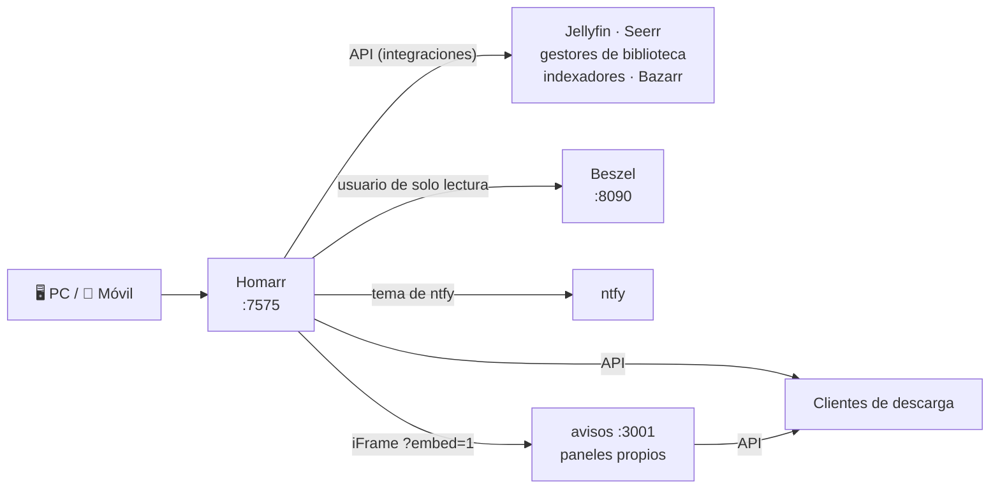

# Panel principal: Homarr

[← Volver al README](../README.md)

Desde el **26 de octubre de 2026**, **Homarr** (v2) es la página de inicio del homelab: un único tablero desde el que veo el estado de todo y salto a cualquier servicio. Sustituye a **Homepage**, que usé hasta entonces y que quedó **retirado el 31 de octubre** (ver [Cómo era antes](#cómo-era-antes-homepage)).

<!-- 📸 Captura del tablero en el PC: images/homarr-escritorio.png -->

## Por qué el cambio

Homepage funcionaba bien, pero toda su configuración está en archivos YAML: para mover un widget o añadir un servicio hay que editar texto y recargar. Homarr se configura desde la propia web y su interfaz me gustaba más.

| | Homepage (antes) | Homarr (ahora) |
|---|---|---|
| Configuración | Archivos YAML | Desde la web; se guarda en su base de datos |
| Edición | Editar el YAML y recargar | Modo edición: arrastrar, soltar y cambiar el tamaño |
| Integraciones | Un widget por servicio, con claves en variables `HOMEPAGE_VAR_*` | Integraciones con botón de **probar conexión**; credenciales guardadas **cifradas** |
| Diseño | Grupos en columnas | Rejilla con **varios diseños según el ancho** de pantalla (PC, móvil) |
| Estilo | Temas incluidos | Tema propio con **CSS personalizado** por tablero |
| RAM en reposo | ~100 MB | ~150–200 MB |
| Puerto | 3000 | 7575 |

Medido antes de decidir: Homarr arranca en unos 5 s y en reposo gasta un poco más de RAM, algo asumible incluso en el servidor nuevo de 8 GB.

## Despliegue

Va en el `docker-compose.override.yml`, junto al resto de extras, y también está incluido en el kit de mudanza al servidor nuevo.

```yaml
  # Panel principal (versión simplificada)
  homarr:
    image: ghcr.io/homarr-labs/homarr:latest
    container_name: homarr
    env_file: ./hub/homarr.env       # SECRET_ENCRYPTION_KEY
    volumes:
      - homarr-appdata:/appdata      # base de datos: tableros, apps, integraciones
    ports:
      - "7575:7575"
    restart: unless-stopped
```

- **`SECRET_ENCRYPTION_KEY`** cifra las credenciales de las integraciones que guarda Homarr. Va en su propio `.env`, fuera del compose. Si se cambia, Homarr ya no puede descifrarlas y hay que volver a meter todas las claves; por eso viaja con el kit de mudanza junto al volumen.
- **`homarr-appdata`** contiene toda la configuración. El script de exportación del kit de mudanza lo empaqueta igual que los demás volúmenes.
- **Vuelta atrás:** `docker compose rm -sf homarr` y Homepage sigue funcionando como si nada.

## Cómo se conecta



**Desde el 29-oct, Homarr se abre desde fuera por [Tailscale](09-acceso-privado-tailscale.md)** (`http://homelab.<mi-red>.ts.net:7575`), y los botones de acceso pasan a usar ese mismo nombre, así que funcionan en casa, fuera y después de la mudanza.

Las **integraciones** apuntan a los servicios por su **nombre de contenedor** (`http://jellyfin:8096`, `http://beszel:8090`…) y no por la IP del PC. Docker resuelve esos nombres dentro de su red, así que al mudarme al servidor nuevo **no hay que tocar ninguna**. Los botones de acceso, en cambio, los abre el navegador desde fuera de Docker: antes llevaban la IP de casa y ahora el nombre de Tailscale. Hay excepciones en el servidor (desde el 31-oct), que usan la IP de casa del servidor en lugar del nombre del contenedor: **Home Assistant**, porque va en la red del host y no en la de Docker, y las integraciones de **Prowlarr y Jackett**. Para que esas llamadas funcionen, el cortafuegos del servidor tiene que dejar pasar el tráfico de las redes de Docker (ver [Servidor](08-servidor-nuevo.md#lo-que-aprendí-en-la-mudanza)).

| Integración | Qué aporta |
|---|---|
| Jellyfin | Quién está viendo qué y en qué aparato |
| Gestores de biblioteca | Cola, elementos pendientes y calendario de estrenos |
| Seerr | Lista de peticiones |
| Prowlarr / Jackett | Estado de cada indexador |
| Clientes de descarga | Estado de las descargas |
| Bazarr | Subtítulos pendientes |
| ntfy | Las mismas notificaciones que llegan al móvil |
| Beszel | CPU, RAM, discos y estado de cada máquina |
| AdGuard Home | Consultas DNS y porcentaje bloqueado (widget DNS Hole), desde el 31-oct |
| Immich y Nextcloud | En la lista de apps con su punto de estado, desde el 1-nov |
| Home Assistant | Estado de la alarma y del sensor de ambiente (en marcha) |

**Detalle de seguridad:** Beszel se conecta con un **usuario propio de solo lectura** (en Beszel el inicio de sesión es con el correo, no con el nombre de usuario), para que Homarr no use la cuenta de administrador. Las claves de API salen del mismo `.env` que usan los demás servicios, nunca del compose.

## El tablero

### Diseño

| Ajuste | Valor |
|---|---|
| Diseño base | Breakpoint **1200 px**, **14 columnas**, sin barras laterales |
| Tema | "Aurora / glass" en *Custom CSS* (~8 KB): fondo con degradados y tarjetas translúcidas |

Orden aproximado, de arriba abajo, para que lo que más miro quede arriba:

1. **Paneles de descargas** en directo, a lo ancho (iFrames de los [paneles propios](#paneles-propios-dentro-de-homarr)).
2. **Estado de las máquinas**: gráficas de CPU y RAM y tarjetas por sistema (Beszel).
3. **Notificaciones** (ntfy) y **estado de los indexadores**.
4. **Reproducción**: quién está viendo algo en Jellyfin.
5. **Accesos** a todas las aplicaciones.

| Widget | Origen | Qué muestra |
|---|---|---|
| iFrame × 2 | Paneles propios | Descargas por Usenet y BitTorrent en directo |
| Beszel System Stats | Integración | Gráficas de CPU y memoria |
| Beszel Systems | Integración | Una tarjeta por máquina, con su estado |
| Notifications | Integración ntfy | Últimas notificaciones |
| Indexer manager status | Integración Prowlarr + Jackett | Qué indexadores responden y cuáles fallan |
| Media server streams | Integración Jellyfin | Reproducciones en curso |
| Categorized App List with Status Dots | Widget de la comunidad | Botones de todas las apps, por categorías, con un punto de estado (verde, naranja o rojo) |

### Tema "cristal"

Sobre el tema base añadí reglas propias para que todo case con el mismo estilo de cristal translúcido. Por ejemplo, la lista de apps es un widget de la comunidad que no seguía el tema, así que le puse la clase `cristal` (*Custom CSS classes* del widget) y la estilé reutilizando las variables del propio tema:

```css
/* Botones de la lista de apps, a juego con el tema */
.cristal a {
  background: var(--glass-bg) !important;
  border: 1px solid var(--glass-border) !important;
  border-radius: 12px !important;
  box-shadow: inset 0 1px 0 var(--glass-highlight);
  backdrop-filter: blur(8px);
  transition: background .2s var(--ease-smooth);
}
.cristal a:hover {
  background: rgba(255, 255, 255, 0.12) !important;
}

/* Marco de los iFrames: esquinas redondeadas y sin fondo opaco */
iframe {
  border-radius: 12px;
  color-scheme: dark;
  background: transparent;
}
```

Al reutilizar las variables del tema (`--glass-bg`, `--glass-border`…), si algún día cambio los colores del tema, los botones cambian con él.

## Paneles propios dentro de Homarr

Los widgets de descargas que trae Homarr son pequeños y dan poca información, así que hice dos paneles a medida. Los sirve el mismo servicio en Python que manda los avisos (puerto 3001) y se meten en Homarr como **iFrame**.

<!-- 📸 Captura de los dos paneles dentro de Homarr: images/homarr-paneles.png -->

| Ruta | Qué muestra |
|---|---|
| `/nzb?embed=1` | Usenet: velocidad, qué se está descargando y qué archivo, progreso, tiempo restante, postproceso, cola y lo último terminado |
| `/torrents?embed=1` | BitTorrent: bajada, subida, ratio y total subido, con los torrents **agrupados por proveedor** (los grupos se configuran con una variable) |
| `/api/nzb`, `/api/torrents` | Los mismos datos en JSON, sin claves |

- **`?embed=1`** sirve una versión sin título y con **fondo transparente**, para que se vea la tarjeta de Homarr detrás y encaje con el tema cristal. La versión normal es una página completa con su propio fondo.
- Se **refrescan cada 3 segundos**, con una caché de 2 s para no saturar a los clientes de descarga.
- Al **hacer clic** en una descarga se abre su cliente.
- Los iconos van incrustados en la página, para que no dependa de nada externo.
- Antes de instalarlos, los probé contra **servidores simulados** de los dos clientes y revisé el resultado con capturas hechas con Chromium.

Más detalle del servicio en [Avisos y paneles propios](06-avisos-y-paneles.md).

## Lo que aprendí montándolo

**Los diseños funcionan por ancho de pantalla.** Homarr usa el diseño con el breakpoint más alto que quepa en la ventana. Tenía, sin saberlo, un segundo diseño de 1440 px con **barras laterales fijas**; mi monitor es más ancho, así que veía ese y no el que estaba ordenando, con dos franjas vacías a los lados. Lo borré y me quedé solo con el diseño base de 1200 px.

**Los widgets se comparten entre diseños.** Cada diseño (PC, móvil) guarda solo la **posición y el tamaño** de cada widget, pero los widgets son los mismos. Si en el diseño de móvil **borras** un widget, desaparece también del PC. Lo que no quieras en el móvil se manda al final, no se borra.

**Un iFrame no es transparente por defecto.** Aunque la página de dentro tenga fondo transparente, el navegador pinta un fondo opaco en el marco si la página y el tablero no "coinciden" en modo oscuro. Hacen falta las dos cosas: `color-scheme: dark` en la página embebida y en el `iframe`, y esquinas redondeadas en el marco para que coincidan con las de la tarjeta.

**Los puntos de estado dicen la verdad, pero hay que leerlos bien.**
- El de **ntfy** salía en rojo, aunque las notificaciones llegaban: la app apuntaba a una dirección que no responde a una comprobación simple. Se arregla apuntándola a `https://ntfy.sh/v1/health`.
- El de **Jackett** salía en naranja por indexadores que fallaban.

**Un timeout de 250 ms con Docker Desktop no llega (28-oct).** El widget de notificaciones fallaba y el log de Homarr se llenaba de `ETIMEDOUT` hacia ntfy.sh, aunque los avisos y las alertas de Beszel sí llegaban. La pista estaba en el log: `durationMs="261"`.
- **Causa:** Node (el motor de Homarr) prueba las direcciones IPv6 e IPv4 de un servidor dando a cada intento solo **250 ms** (*happy eyeballs*). ntfy.sh está en Nueva York (~100 ms de ida y vuelta) y la capa WSL2 de Docker Desktop añade más; además, la IPv6 no es alcanzable desde el contenedor (`ENETUNREACH`).
- **Comprobación:** la misma petición desde dentro del contenedor fallaba con el valor por defecto y respondía `{"healthy":true}` con 2 s de margen.
- **Arreglo:** `NODE_OPTIONS=--network-family-autoselection-attempt-timeout=2000` en el `.env` de Homarr (también en el kit del servidor), aplicándolo con `docker compose up -d`, porque `restart` no relee el `.env`.

**Un contenedor no debe llamarse a sí mismo por la IP de casa.** Un widget pedía datos a `http://<IP-de-casa>:7575`. Esa petición no la hace el navegador, sino el propio contenedor, y con Docker Desktop salir hacia la IP del PC para volver a entrar en el mismo contenedor se queda colgado. Dentro del contenedor, Homarr es `http://localhost:7575`.

**El tablero sirve para mantener, no solo para mirar.** El widget de indexadores dejó a la vista **indexadores duplicados** (dados de alta a la vez en Prowlarr y en Jackett) y otros que fallaban en cada búsqueda y solo la ralentizaban. Con eso reorganicé los indexadores y quité los que sobraban.

## Cómo era antes: Homepage

Del inicio del proyecto hasta el 26 de octubre, el panel era **Homepage** ("hub", puerto 3000):

- Configuración en YAML dentro de la carpeta `hub/`.
- Un widget por servicio, con las claves de API en `hub/.env` como variables `HOMEPAGE_VAR_*`.
- La página **"Actividad"** del servicio de avisos, incrustada con `?embed=1`.

<!-- 📸 Captura del panel Homepage (antes): images/hub.png -->

**Retirado el 31 de octubre**, ya en el servidor nuevo: se quitó su servicio del compose (y del kit de mudanza) y se aplicó con `docker compose up -d --remove-orphans`. Nada dependía del contenedor: los avisos y los paneles leen las mismas variables `HOMEPAGE_VAR_*` del `.env`, que se quedan con ese nombre. Su configuración se conserva en `hub/homepage/` por si algún día quiero volver.

## Pendiente

- [x] Retirar Homepage (31-oct).
- [ ] Cambiar las direcciones de los botones de acceso al nombre de Tailscale.
- [ ] Diseño de móvil (breakpoint 0, 2 columnas), ordenado desde el propio móvil.
- [ ] Calendario de estrenos y lista de peticiones en el hueco que deja el panel de Usenet cuando no descarga nada.
- [x] Revisar las X rojas del historial del panel de Usenet: eran borrados manuales marcados como fallo (arreglado el 31-oct, ver [Avisos y paneles](06-avisos-y-paneles.md#el-panel-de-descargas-que-mentía-31-oct)).
- [ ] Integración con **Home Assistant** (token de larga duración) y widgets con el estado de la alarma. Ver [Domótica](10-domotica-home-assistant.md).
- [ ] Comprobar que el arreglo del timeout de ntfy quedó aplicado (`docker exec homarr printenv NODE_OPTIONS`).
