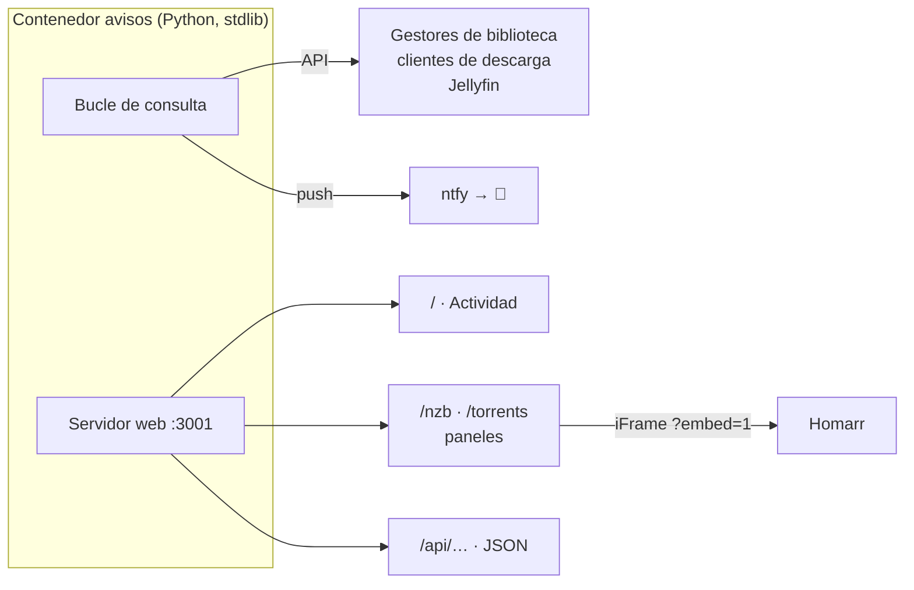

# 🔔 Avisos y paneles propios

[← Volver al README](../README.md)

Servicio hecho a medida en **Python, solo con la librería estándar** (nada que instalar). Corre en su propio contenedor, guarda su estado en un volumen y hace tres cosas:

1. **Notificaciones al móvil** por **ntfy**.
2. Una página web de **"Actividad"**.
3. Los **paneles de descargas** que se ven dentro de [Homarr](05-panel-homarr.md).

## Notificaciones

Consulta periódicamente las APIs de los servicios y manda por ntfy:

- ✅ Lo que se ha añadido a la biblioteca.
- ❌ Las descargas que han fallado, con el motivo.
- 🔐 Las alertas de seguridad de Jellyfin (ver [Acceso remoto y seguridad](03-acceso-remoto-y-seguridad.md#alertas-al-móvil)).

Desde el 31-oct funciona en el servidor nuevo (con un aviso de prueba comprobado). Al pulsar una notificación se abre **Homarr** (antes abría Homepage). Desde el 29-oct, el enlace usa el nombre de [Tailscale](09-acceso-privado-tailscale.md) en lugar de la IP de casa, así que funciona también fuera de casa.

## Página "Actividad"

<!-- 📸 Captura de la página Actividad: images/actividad.png -->

Dos listas:

- **Añadido:** lo último que ha entrado en la biblioteca, con calidad, idiomas, tamaño y cliente de descarga.
- **Fallido:** las descargas que han fallado, con el **motivo explicado en castellano** y el detalle técnico debajo.

Algunos ejemplos de cómo traduce los estados de NZBGet:

| Estado de NZBGet | Motivo que muestra |
|---|---|
| `PAR / FAILURE` | No se pudo reparar: faltan bloques y no hay suficientes par2 |
| `UNPACK / SPACE` | Sin espacio en disco al descomprimir |
| `UNPACK / PASSWORD` | El archivo pide contraseña |
| `DELETE / HEALTH` | Cancelado: faltan demasiados artículos en el servidor |
| `DELETE / DUPE` | Descartado por duplicado |

Tiene una versión compacta (`/?embed=1`) para incrustarla en un panel y los mismos datos en JSON (`/api`).

## Paneles de descargas

Añadidos el 26 de octubre para el tablero de Homarr (archivo `paneles.py`, en el mismo servidor web):

| Ruta | Contenido |
|---|---|
| `/nzb` | Usenet: velocidad, descarga y archivo actuales, progreso, tiempo restante, postproceso, cola y últimos terminados |
| `/torrents` | BitTorrent: bajada, subida, ratio y total subido, con los torrents agrupados por proveedor |
| `?embed=1` | Versión sin título y con fondo transparente, para meterla en un iFrame |
| `/api/nzb`, `/api/torrents` | Los mismos datos en JSON |

- **Refresco cada 3 s** en el navegador y **caché de 2 s** en el servidor, para que varias pestañas abiertas no multipliquen las peticiones a los clientes.
- **Nada sensible en la salida:** el JSON no incluye claves ni identificadores privados.
- **Configurables por variables** del `.env`: los grupos de proveedores y la dirección que se abre al hacer clic en una descarga.
- **Estilo cristal** en la versión `embed`: tarjetas translúcidas, barra de scroll fina y `color-scheme: dark`, para que encajen con el tema de Homarr.
- **Probados antes de instalarlos** contra servidores simulados de NZBGet y qBittorrent, revisando el resultado con capturas de Chromium.

## Arreglos del 26 de octubre

Al montar los paneles vi que los avisos de qBittorrent y NZBGet llevaban días sin llegar. Había dos fallos a la vez:

**1. qBittorrent 5.2 cambió su inicio de sesión.**
- Antes, `POST /api/v2/auth/login` respondía `Ok.`; ahora responde **204 sin cuerpo**, y el script lo tomaba como un fallo.
- Además, la cookie de sesión no se reenviaba sola en las siguientes peticiones.
- **Solución:** aceptar el 204 como éxito y mandar la cookie de sesión a mano.
- **Extra:** qBittorrent **bloquea la IP tras 5 intentos fallidos**. Un script que reintenta cada minuto con una contraseña mala acaba bloqueándose a sí mismo, así que ahora, tras un fallo de inicio de sesión, espera 10 minutos antes de volver a intentarlo.

**2. Dos líneas estropeadas.** En una edición anterior, las líneas que leían el usuario y la contraseña de las variables de entorno habían quedado con los **valores escritos a mano** en lugar de los nombres de las variables. Corregido.

**Aprendido:** las copias `.bak` que se hacen antes de editar un archivo que contiene credenciales también son secretos, y hay que tratarlas igual.

## El panel de descargas que mentía (31-oct)

En el historial del panel de Usenet salían varias descargas con una X roja aunque se habían importado bien.

- **Causa 1:** el panel marcaba como fallo las descargas **borradas a mano**.
- **Causa 2:** las descargas correctas apenas aparecían, porque el gestor de biblioteca las quita del historial del cliente **a los 18 segundos de importarlas**.
- **Solución:** el panel lee también el historial de los gestores de biblioteca y oculta los borrados manuales. Ahora una **X roja significa un fallo real**.

## Pendiente

- [ ] Los avisos de seguridad de Jellyfin: su clave de API da error 401 desde la mudanza.

