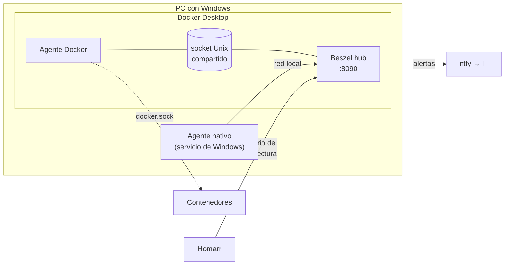

# Monitorización: Beszel

[← Volver al README](../README.md)

Desde el **27 de octubre de 2026**, **Beszel** vigila los recursos de las máquinas del homelab, y desde el **31 de octubre** vive en el servidor nuevo. Hasta entonces no tenía forma de saber qué contenedor se comía la RAM ni cómo iban los discos sin abrir el Administrador de tareas.

<!-- 📸 Captura de Beszel: images/beszel.png -->

## Qué mide

- **CPU, RAM, red y temperatura** de cada máquina.
- **Discos:** espacio, lectura y escritura, y **salud SMART**.
- **Cada contenedor por separado:** cuánta CPU y RAM gasta cada servicio.
- **Historial** de horas y días, no solo el momento actual.

Lo elegí porque es **muy ligero** (importante para los 8 GB del servidor nuevo), avisa por el **mismo ntfy** que el resto del homelab y **Homarr tiene widgets propios** para él.

## Cómo está montado



| Sistema en Beszel | Agente | Qué ve |
|---|---|---|
| **Windows** | Binario nativo, instalado como **servicio de Windows** (NSSM), con `smartctl` | El PC real: CPU, RAM, discos C:, E: y J: (añadidos con `EXTRA_FILESYSTEMS`) y su salud SMART |
| **Docker** | Contenedor | Cada contenedor y la máquina virtual de Docker Desktop |

El hub y el agente de Docker hablan por un **socket Unix en un volumen compartido**, sin abrir ningún puerto de red entre ellos. El agente necesita el socket de Docker para ver los contenedores.

> **Corrección:** al principio di por hecho que montar `docker.sock` con `:ro` lo dejaba en "solo lectura". No es así: `:ro` solo impide modificar el archivo del socket, pero a través de él se puede hablar con toda la API de Docker. La protección real es poner delante un **docker-socket-proxy** que solo deje pasar las consultas de lectura que necesita Beszel; está en el [plan de seguridad](03-acceso-remoto-y-seguridad.md#plan-de-seguridad-por-fases).

```yaml
  beszel:
    image: henrygd/beszel:latest
    container_name: beszel
    volumes:
      - beszel-data:/beszel_data
      - beszel-socket:/beszel_socket
    ports:
      - "8090:8090"
    restart: unless-stopped

  beszel-agent:
    image: henrygd/beszel-agent:latest
    container_name: beszel-agent
    env_file: ./hub/beszel.env              # KEY y TOKEN, generados por la web de Beszel
    environment:
      LISTEN: /beszel_socket/beszel.sock
      HUB_URL: http://beszel:8090
    volumes:
      - beszel-agent-data:/var/lib/beszel-agent
      - beszel-socket:/beszel_socket
      - /var/run/docker.sock:/var/run/docker.sock:ro
    restart: unless-stopped
```

## Alertas

Por ntfy, al mismo tema que el resto de avisos (`ntfy://ntfy.sh/<tema>`). Umbrales de partida:

| Alerta | Cuándo |
|---|---|
| Máquina caída | No responde durante 2 min |
| CPU | > 90 % durante 10 min |
| Memoria | > 90 % durante 10 min |
| Disco | > 90 % de ocupación |
| Temperatura | > 85 °C durante 5 min |
| Salud SMART | Cualquier fallo de un disco (automático) |

## Integraciones

### Con Homarr

| Ajuste | Valor |
|---|---|
| URL | `http://beszel:8090`, el nombre del contenedor, así que no cambia en la mudanza |
| Usuario | Uno de Beszel **solo para Homarr y de solo lectura**, para no usar el administrador |
| Inicio de sesión | Con el **correo** del usuario, no con su nombre (es lo que pide Beszel) |
| Widgets | **System Stats** (gráficas de CPU y memoria) y **Systems** (una tarjeta por máquina con su estado) |

### Con ntfy

Las alertas van al mismo tema de ntfy que el resto de avisos del homelab, así que todo llega al móvil por el mismo canal.

### Con Tailscale (29-oct)

Los enlaces de las alertas de Beszel (`APP_URL`) apuntan ahora al nombre de Tailscale del homelab en lugar de a la IP de casa: al pulsar una alerta fuera de casa, se abre Beszel igualmente. En el servidor, `restaurar.sh` escribe ese nombre en el `.env` y Beszel lo lee de ahí. Ver [Acceso privado: Tailscale](09-acceso-privado-tailscale.md).

## Lo primero que enseñó

Nada más arrancarlo, el PC con Windows estaba al **83 % de RAM** y al **88 % de disco en C:**. La RAM va justa pero bien; el disco C: es la siguiente cosa a revisar (lo más probable es que vuelva a ser el disco virtual de Docker, como ya pasó una vez: ver [Problemas resueltos](14-problemas-resueltos.md#disco-c-casi-lleno)).

## En el servidor nuevo (31-oct)

Se mudó con el kit, conservando el historial:

- **El mismo hub se muda** con su volumen (`beszel-data`), así que se conserva el historial y la configuración.
- **Agente del servidor:** imagen `alpine` con `smartctl`, en `network_mode: host` para ver las tarjetas de red reales, con los permisos justos para leer SMART (`SYS_RAWIO`, `SYS_ADMIN`).
- **Discos detectados solos:** el script de restauración busca los discos con `lsblk` y añade al compose los dispositivos para SMART y los puntos de montaje de datos y copias.
- El sistema "Docker" pasó a llamarse **"Servidor"**, y el PC con Windows sigue enviando sus datos con su agente nativo: las dos máquinas se ven en el mismo sitio.

**Ajustes de la mudanza:**
- **"Fingerprint mismatch":** el sistema guardaba la huella del agente de Docker Desktop, y el agente nuevo del servidor tiene otra. Se borra la huella guardada en los ajustes de tokens del hub y el agente vuelve a conectar.
- **El PC deja de ser `host.docker.internal`:** el agente de Windows ahora está en otra máquina, así que el PC tiene una IP fija en el router y una regla en el firewall de Windows que solo deja entrar al servidor en el puerto del agente (45876).
- **Widgets de Homarr vacíos:** el usuario de solo lectura de Homarr solo ve los sistemas que se le comparten expresamente en Beszel.
- **El disco de copias, por identificador (1-nov):** va por USB y, tras una desconexión, vuelve con otro nombre de dispositivo (`/dev/sdX`). Beszel lo vigila por su identificador estable, que no cambia. Ver [Copias de seguridad](12-copias-de-seguridad.md#el-disco-de-copias-inestable-y-vigilado).
- Pendiente: poner un **docker-socket-proxy** delante del socket de Docker.

**Uso actual (2-nov):** 29 contenedores con 4,6 GiB de RAM en uso de 14,9 GiB disponibles.
