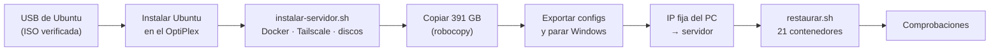

# Servidor: Dell OptiPlex 7060 SFF

[← Volver al README](../README.md)

**En marcha desde el 31 de octubre de 2026.** Todo el homelab corre en un Dell OptiPlex 7060 SFF de segunda mano con Ubuntu Server, y mi PC con Windows vuelve a ser solo mi ordenador personal. A 2 de noviembre mueve **29 contenedores con 4,6 GiB de RAM en uso**.

Hasta entonces el homelab vivía en el PC, con Docker Desktop. Funcionaba, pero dependía de que el PC estuviera encendido, Docker Desktop añadía una capa (WSL2) que frenaba el disco y ocultaba la IP real de las visitas, y le quitaba recursos al uso diario.

## Por qué no es un paso atrás

Sobre el papel, el cambio parece un *downgrade* en toda regla:

| | PC con Windows (antes) | OptiPlex (ahora) |
|---|---|---|
| CPU | AMD Ryzen 5 5600, 6 núcleos / 12 hilos | Intel Core i5-8500 de 2018, 6 núcleos / 6 hilos |
| RAM | 16 GB | 8 GB (ampliada a 16 GB el 31-oct, con dos módulos de segunda mano) |
| Disco de datos | HDD de 2 TB | HDD de 1 TB |

**En la práctica rinde mucho mejor**, porque el límite nunca fue la potencia del procesador, sino todo lo que había alrededor:

- **El disco a través de Docker Desktop era el verdadero cuello de botella.** En Windows, cada byte pasaba por la máquina virtual de WSL2 y acababa en un disco SMR, que se hunde con escrituras largas y desordenadas. En Ubuntu, Docker escribe directamente en los discos, la parte temporal de las descargas va al SSD y el disco de datos es CMR.
- **La gráfica integrada hace el trabajo pesado del vídeo.** El i5-8500 trae Intel Quick Sync, que transcodifica por hardware. El procesador ni se entera.
- **Una máquina dedicada no compite con nadie.** En el PC, los contenedores peleaban con lo que yo estuviera haciendo (Beszel marcaba el PC al 83 % de RAM), y cualquier reinicio o actualización de Windows tumbaba el homelab. En el servidor, los mismos 21 servicios cabían con holgura en 8 GB. Con la RAM ampliada a 16 GB, hoy corren **29 contenedores usando solo 4,6 GiB**: sin Windows ni WSL2 de por medio, cada contenedor gasta lo que necesita y nada más.
- **Consume y ocupa mucho menos**, y la RAM se puede ampliar barata (4 ranuras, hasta 64 GB) si algún día hace falta.

### Los resultados

| | PC con Windows + Docker Desktop | OptiPlex con Ubuntu |
|---|---|---|
| **Descargas por Usenet** | ~10 MB/s | **84,9 MB/s** (≈680 Mbps): **más de 8 veces más rápido**, cerca del máximo práctico de la fibra de 1 Gb |
| **Transcodificar vídeo** | Con el procesador | Con la gráfica integrada: en una prueba forzada, el motor de vídeo al ~34 % y la CPU libre |
| **Archivos nuevos** | Jellyfin y Bazarr no se enteraban hasta el siguiente escaneo | Al momento (`inotify`) |
| **IP real de las visitas** | Solo sacando Caddy de Docker | Sí, con Caddy en su contenedor |
| **Disponibilidad** | Mientras el PC estuviera encendido | 24/7 |
| **Servicios** | 21 contenedores compitiendo con el uso diario del PC (RAM del PC al 83 %) | 21 contenedores en 8 GB el 31-oct; **29 contenedores con 4,6 GiB de RAM en uso** el 2-nov, tras ampliar a 16 GB y sumar DNS, fotos y archivos |

**Dónde sí se nota la CPU más modesta:** en las tareas puntuales y pesadas, como reparar y descomprimir descargas, analizar intros o sincronizar subtítulos. Tardan algo más, pero hablamos de minutos y no afectan a nada de lo que se usa en el día a día.

> **Y el mejor resultado no sale en ninguna tabla:** después de una semana con mi PC personal encendido día y noche, sufriendo con todos los contenedores a cuestas, por fin lo puedo apagar.

### La prueba (28-oct)

Antes de la mudanza quise comprobar que el freno era la capa de Docker y no el PC. Instalé **NZBGet nativo en Windows**, fuera de Docker, escribiendo en el mismo disco:

| Montaje | Velocidad de descarga | |
|---|---|---|
| NZBGet en Docker Desktop, disco SMR del PC | ~10 MB/s | medido |
| NZBGet nativo en Windows, mismo disco | 15–25 MB/s | medido |
| **OptiPlex: temporal en SSD, datos en HDD CMR, por cable** | **84,9 MB/s** | **medido el 31-oct** (estimación previa: 90–110) |
| Techo de la fibra de 1 Gb | ~117 MB/s | teórico |

Solo con quitar Docker Desktop de en medio, la velocidad se duplicaba; el resto lo frenaba el propio disco SMR. En el servidor desaparecen los dos frenos a la vez. Aún queda margen: subiendo las conexiones simultáneas al proveedor se puede rozar el máximo de la fibra.

Detalles del montaje de prueba: el NZBGet nativo usaba otro puerto (el 6789 lo tenía Docker), su propia cola y carpeta temporal, y **solo compartía la carpeta de completados** con el de Docker, para que no se pisaran la cola.

**Para cuando compre un disco más grande:** que sea CMR. Las gamas para NAS (WD Red Plus o Pro, Seagate IronWolf, Toshiba N300) lo son; muchos discos baratos de escritorio, no.

## Hardware

<!-- 📸 Foto del OptiPlex por dentro: images/optiplex-interior.jpg -->

| Componente | Especificación |
|---|---|
| Equipo | Dell OptiPlex 7060 SFF (llegó el 30-oct) |
| CPU | Intel Core i5-8500, 6 núcleos, gráfica UHD 630 (Quick Sync, driver `iHD`) |
| RAM | 16 GB DDR4-2400 en doble canal (2 × 8 GB, ampliada el 31-oct; 4 ranuras, hasta 64 GB) |
| Huecos | 1 bahía de 3,5" (o 2 de 2,5"), 1 bahía óptica fina, 1 M.2 NVMe, 3 puertos SATA |
| Red | Gigabit, por cable al switch |
| Sistema | Ubuntu Server 26.04.1 LTS, sin LVM |

## Discos y su papel

| Disco | Papel | Punto de montaje |
|---|---|---|
| SSD Crucial MX500 500 GB | Sistema, configuraciones y carpeta temporal de descargas | `/` y `/srv/rapido` |
| HDD Toshiba DT01ACA100 1 TB (CMR), por SATA | Datos: biblioteca, descargas, fotos y archivos (hardlinks) | `/srv/data` |
| HDD WD WD10EZEX 1 TB, por USB | Copias diarias de configuraciones, fotos y archivos | `/srv/copias` |

La carpeta temporal de las descargas por Usenet va en el SSD para que los HDD no sufran las escrituras desordenadas de muchas piezas a la vez.

**Montaje definitivo (31-oct):** SSD en la bahía óptica con un adaptador (*caddy*), HDD de datos en la bahía de 3,5" por SATA y el disco de copias por USB 3, con alimentación propia y montado con `nofail` para que el servidor arranque aunque no esté. El disco de datos se había formateado mientras iba por USB; al estar montado por etiqueta, pasarlo a SATA no exigió reformatear.

**Ocupación (2-nov):** datos 396 GB de 916 (biblioteca 342 GB, fotos 11 GB); sistema 34 GB de 457; copias 4 GB de 916.

El disco de copias ha dado problemas de conexión USB: ver [Copias de seguridad](12-copias-de-seguridad.md#el-disco-de-copias-inestable-y-vigilado).

## Salud de los discos

Revisados con SMART (CrystalDiskInfo, por USB) antes de decidir nada:

| Disco | Resultado |
|---|---|
| **SSD MX500** | Bueno. 64 % de vida restante, 9.281 h, 48 TB escritos, 0 bloques reasignados y firmware al día. 5 errores CRC: a vigilar; si suben, cambiar el cable SATA |
| **Toshiba** | Bueno. Todos los contadores de errores a 0. ~11.450 h |
| **WD** | ~44.500 h. Tenía 1 sector pendiente: tras un `clean all` con `diskpart`, pasó a 0 sin reasignarse ningún sector. **Prueba SMART larga superada el 31-oct** en el servidor: 0 reasignados, 0 pendientes, 0 errores CRC. El contador de no corregibles sigue en 2, vigilado |

**Decisión:** el Toshiba, impecable, guarda la biblioteca; el WD, de historial dudoso, guarda las copias. Si falla, solo se pierde la copia, no la biblioteca.

**Lo que aprendí por el camino:**

- Con los dos HDD conectados a la vez, **el adaptador USB mezclaba los datos SMART**: salían cifras idénticas en los dos y un falso "Malo". Hay que revisarlos de uno en uno.
- CrystalDiskInfo mostraba mal las horas de uso del WD (741 h en lugar de ~44.500).
- El SSD del servidor es **el mismo modelo que el disco del sistema del PC**. Antes de limpiar nada en `diskpart`, comprobaba el número de serie y que el disco no tuviera la unidad C:, para no borrar el equivocado.

## Decisiones

- **Ubuntu Server 26.04.1 LTS + Docker**, con el mismo `docker-compose` que en Windows. Se eligió la versión 26.04.1 en lugar de la original de abril porque ya incluye meses de correcciones. Proxmox, descartado de momento: con 8 GB tiene más sentido Docker directamente sobre el sistema.
- **Nada se instala ni se formatea desde el PC con Windows:** todo en el propio OptiPlex. Hacerlo desde el PC arriesga el arranque de Windows, el nombre de la tarjeta de red cambia, el script detecta la máquina real y Windows no escribe ext4.
- **El servidor hereda la IP fija del PC**, y el PC pasa a otra IP fija. Así no hubo que tocar las redirecciones de puertos del router, las apps de Jellyfin de las teles, los botones de Homarr ni los marcadores.
- **Rutas iguales dentro de los contenedores** (`/data/...`), así no hay que reconfigurar ninguna aplicación.
- **Caddy vuelve a Docker**, porque en Linux sí se ve la IP real.
- **Contraseñas fuera del compose**, en el `.env` del servidor.
- **Tailscale en el sistema, no en Docker**, con Tailscale SSH. Ver [Acceso privado: Tailscale](09-acceso-privado-tailscale.md).
- **Home Assistant con `network_mode: host`**, para que descubra teles y Chromecast de la red. Ver [Domótica](10-domotica-home-assistant.md).
- **Espacio:** la biblioteca y las descargas ocupan unos 390 GB de los 916 del disco de datos. Al pasar de ~800 GB habrá que comprar un disco más grande o ajustar los perfiles de calidad.

## La mudanza (30–31 de octubre)

1. **USB de instalación:** Ubuntu Server 26.04.1 con Rufus. Antes de usarlo, comprobé que la huella SHA-256 de la ISO coincidía con la oficial y que los 831 archivos de la lista de control de Ubuntu estaban en el USB.
2. **Instalación** solo en el SSD, sin LVM, con OpenSSH y sin ningún paquete *snap* (Docker lo instala el script, no la tienda).
3. **`instalar-servidor.sh`:** Docker, Tailscale, herramientas SMART, formateo del disco de datos (pide escribir `BORRAR`), Samba y cortafuegos.
4. **Copia de la biblioteca:** 391 GB con `robocopy`, **0 errores, a 125 MB/s, en 56 minutos**.
5. **Exportar y parar Windows** (`1-exportar-windows.ps1 -Final`): configuraciones exportadas y el PC renombrado a `pc` en Tailscale.
6. **Cambio de IP:** el servidor toma la IP fija que tenía el PC y el PC pasa a otra.
7. **`restaurar.sh`:** 17 volúmenes de configuración restaurados, **21 contenedores arriba**, el nombre `homelab` en Tailscale y el Caddyfile generado con **4.326 rangos de IP de España**. Caddy sacó un certificado nuevo, porque en Windows funcionaba como servicio aparte.
8. **Comprobaciones:** Homarr en verde, Jellyfin desde fuera, avisos al móvil, Quick Sync, Beszel y la primera descarga real (los 84,9 MB/s).

### Lo que aprendí en la mudanza

- **En el instalador de Ubuntu hay que desmarcar LVM.** Con la opción por defecto, Ubuntu solo usa unos 100 GB del disco y deja el resto sin asignar.
- **`robocopy` no conserva los hardlinks.** Lo que estaba enlazado entre las descargas y la biblioteca llegó como archivos separados: hasta ~60 GB duplicados. Pendiente volver a unirlos con `jdupes` o `rdfind`.
- **Un script no siempre dice la verdad sobre lo que ha hecho.** Lancé la exportación final sin permisos de administrador: renombró Tailscale, pero no pudo parar el servicio de Caddy de Windows, y aun así dijo "parado". Lo paré y desactivé a mano. Desde entonces compruebo el resultado de cada paso en lugar de fiarme del mensaje.
- **El servidor venía en hora UTC**, lo que habría movido la copia diaria una hora. `timedatectl set-timezone Europe/Madrid`.
- **El cortafuegos bloqueaba a los propios contenedores.** Los que llaman a la IP del servidor (Homarr hacia algunos servicios, la lista de apps con puntos de estado) daban *Connect Timeout*, porque `ufw` no dejaba pasar el tráfico de las redes de Docker. Arreglo: `ufw allow from 172.16.0.0/12`, también añadido al script de instalación.
- **Fijar versiones cuando una actualización rompe algo.** Con qBittorrent 5.2.4 la web se colgaba, así que la imagen está fijada a la versión anterior en los dos sitios.
- **Plan de vuelta atrás escrito antes de empezar:** parar los contenedores del servidor, arrancar los de Windows y devolver la IP y los nombres de Tailscale. No hizo falta.

## Después de la mudanza: asentar el servidor (31-oct)

### Ampliación de RAM a 16 GB

Con la mudanza hecha, amplié la RAM de 8 a 16 GB (dos módulos DDR4-2400 de 8 GB, de fabricantes distintos) para tener margen para servicios nuevos. Antes de darla por buena:

- `dmidecode` para confirmar los dos módulos y el **doble canal**.
- **Diagnóstico de Dell** (ePSA) sin errores.
- **`memtester`** sobre 8 GB, 2 pasadas, **0 fallos**. Ojo: solo cubrió la mitad de la memoria; una prueba completa necesitaría arrancar MemTest86 desde un USB.

### Conflicto de IP en la red de Docker

- **Síntoma:** después de un reinicio, Caddy no arrancaba (*Address already in use*) y Jellyfin dejó de verse desde fuera.
- **Causa:** Caddy tiene una IP fija en la red de Docker para que Jellyfin lo reconozca como proxy, pero esa IP estaba dentro del rango que Docker reparte automáticamente. Si otro contenedor arrancaba antes, podía quedársela.
- **Solución:** reservar un subrango para las IPs automáticas y dejar las fijas fuera de él.

### Recuperar los hardlinks perdidos

`robocopy` había convertido los hardlinks entre la biblioteca y las descargas en archivos separados.

1. **Medir sin tocar nada:** `jdupes` en un contenedor temporal con el disco montado **en solo lectura**. En 12 minutos: **47 pares duplicados y 49,9 GB recuperables** (46,3 GB en series y 3,5 GB en películas).
2. **Probar las opciones en una carpeta temporal antes de usarlas de verdad.** La prueba destapó que el filtro de tamaño funcionaba al revés de lo que suponía (`size-` *incluye* los archivos pequeños en vez de excluirlos). Con la opción equivocada solo se habrían enlazado los archivos pequeños.
3. **Convertir:** 19 minutos, sin borrar datos. **Se liberaron 46,4 GiB**: de 432 a 386 GiB usados (del 48 % al 43 % del disco).

### Claude Code en el servidor

Con la RAM ampliada, instalé **Claude Code** en el propio servidor, para administrarlo desde el móvil:

- **Remote Control** como **servicio de usuario de systemd con *linger***, para que vuelva solo tras un reinicio. Solo admite una instancia por carpeta, así que se comprobó al pasar de la instancia manual a la del servicio; falta verlo tras un reinicio real.
- **`CLAUDE.md`** con las reglas y la arquitectura del servidor, y **`PENDIENTE.md`** como lista de tareas viva que lee y actualiza en cada sesión.
- **Secretos protegidos:** `settings.json` le prohíbe leer los archivos `.env`. No es una barrera completa (un comando de shell podría leerlos), así que los comandos se revisan antes de aprobarlos.

### Otros ajustes

- **Caddy:** el script que regenera la lista de IPs de España **valida la configuración antes de sustituirla** y recarga sin cortar el servicio. La primera regeneración automática (4.326 rangos) recargó bien y HTTPS siguió respondiendo.
- **Limpieza de seguridad:** eliminada una copia antigua de variables de entorno que tenía permisos más abiertos que el resto de archivos de secretos.

## Kit de mudanza

Cuatro scripts, probados antes de que llegara el servidor (la exportación, en el PC real; los de Linux, en contenedores de prueba) y usados el 30–31 de octubre:

| Paso | Script | Qué hace |
|---|---|---|
| 1 | `1-exportar-windows.ps1` | Exporta todos los volúmenes de configuración (también los de Homarr, Beszel y Home Assistant). Con `-Final` deja la pila de Windows parada y renombra el PC a `pc` en Tailscale. **Hay que lanzarlo como administrador** |
| 2 | `servidor/instalar-servidor.sh` | Instala Docker, **Tailscale** (con SSH) y las herramientas SMART, formatea los discos (pide escribir `BORRAR` para confirmar), comparte las carpetas por Samba y configura el firewall (`ufw`, que admite Tailscale y las redes de Docker). Se puede relanzar: salta lo que ya está hecho |
| 3 | `2-copiar-al-servidor.ps1` | Copia los datos y el kit al servidor con `robocopy` |
| 4 | `servidor/restaurar.sh` | Restaura los volúmenes, le da al servidor el nombre `homelab` en Tailscale, ajusta las IPs de casa, genera el Caddyfile, prepara Beszel (detecta los discos para SMART), arranca todo y programa las tareas (copias, lista de IPs) |

## Pendiente

- [x] Discos en su sitio definitivo y prueba SMART larga del WD (31-oct).
- [x] Volver a unir los hardlinks duplicados por la copia (31-oct, 46,4 GiB recuperados).
- [x] Ampliar la RAM a 16 GB (31-oct).
- [ ] Resolver los cortes USB del disco de copias. Ver [Copias de seguridad](12-copias-de-seguridad.md).
- [ ] Comprobar que Remote Control de Claude Code vuelve solo tras un reinicio real.
- [ ] Vigilar los errores CRC y la vida del SSD, y el espacio del disco de datos (ampliación prevista en el Black Friday).
- [ ] Tras una semana estable, desinstalar Docker Desktop del PC.
