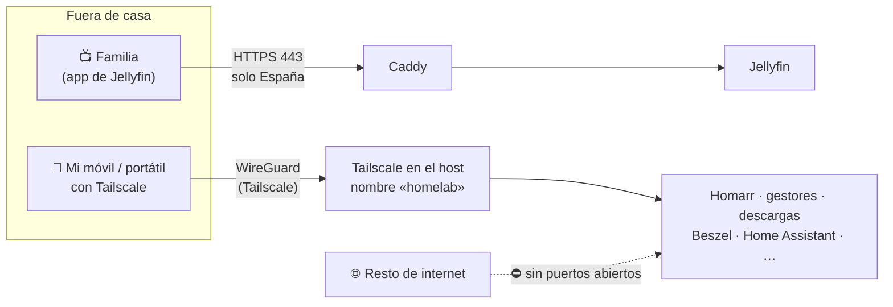
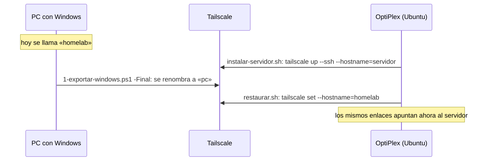

# 🔒 Acceso privado: Tailscale

[← Volver al README](../README.md)

Desde el **29 de octubre de 2026**, todo el homelab **menos Jellyfin** se usa desde fuera de casa a través de **Tailscale**, una red privada (VPN) basada en WireGuard. Así el homelab tiene dos puertas bien separadas:

| Puerta | Qué entra por ella | Quién puede usarla |
|---|---|---|
| **Pública**: Caddy en el 443 | Solo Jellyfin | Cualquiera desde España, con usuario de Jellyfin. Ver [Acceso remoto y seguridad](03-acceso-remoto-y-seguridad.md) |
| **Privada**: Tailscale | Todo lo demás: Homarr, gestores, clientes de descarga, Beszel, Home Assistant… | Solo mis aparatos (y los que yo comparta) con Tailscale encendido |

Antes de esto, todo lo que no fuera Jellyfin solo se podía usar desde casa. Abrir más puertos o publicar más servicios en Caddy no era opción: cuantos más servicios expuestos, más superficie de ataque. Con Tailscale no se abre **ningún puerto nuevo** en el router.

## Decisiones

- **Tailscale en el sistema, no en Docker.** Va instalado en Windows (y después en Ubuntu), no como contenedor ni con un nodo por aplicación. Una sola máquina en la red de Tailscale da acceso a todos los puertos del homelab.
- **Sin HTTPS de Tailscale.** Las apps se abren con `http://homelab.<mi-red>.ts.net:PUERTO`. El navegador dice "No seguro" por el candado, pero el tráfico ya va **cifrado por WireGuard** de extremo a extremo.
- **MagicDNS con un nombre fijo, `homelab`.** Ahora lo tiene el PC con Windows. En la mudanza, el nombre pasa solo al servidor y las direcciones no cambian (ver abajo).
- **Jellyfin se queda fuera de Tailscale** porque lo usa gente que no va a instalar una VPN para ver la tele. Sigue publicado solo con Caddy, con todos sus filtros.
- **En casa todo sigue igual:** la IP local sigue funcionando.

## Instalación en Windows

Un script en PowerShell (`instalar-tailscale-windows.ps1`) lo deja todo hecho:

1. Instala Tailscale con `winget` y lo conecta en modo desatendido (`tailscale up --unattended --hostname=homelab`), con actualizaciones automáticas.
2. Cambia los enlaces del homelab al nombre de Tailscale, para que funcionen desde cualquier sitio:
   - El panel (Homepage) y los avisos: la IP de los enlaces, los hosts permitidos de Homepage y la dirección que se abre al pulsar una notificación.
   - Beszel: la dirección de sus alertas (`APP_URL`).
3. Crea una regla en el **firewall de Windows** ("Homelab por Tailscale") que solo admite conexiones del rango de Tailscale, `100.64.0.0/10`.
4. Reinicia los contenedores afectados y escribe un archivo con todas las direcciones, incluida la IP `100.x` de respaldo por si fallara MagicDNS.
5. Antes de tocar nada guarda copias (`.bak-tailscale`), y la guía explica cómo deshacerlo.

**A mano:** desactivar la caducidad de la clave del equipo en la consola de Tailscale ("Disable key expiry"), instalar la app en el móvil y cambiar las direcciones de los botones de Homarr. Las **integraciones de Homarr no se tocan**, porque usan nombres de contenedor dentro de Docker.

## Mudanza al servidor nuevo

El nombre `homelab` está pensado para que la mudanza sea transparente:

- **`instalar-servidor.sh`** instala Tailscale con **Tailscale SSH** (`ssh usuario@homelab` desde cualquier sitio, sin abrir el puerto 22) y actualizaciones automáticas. El cortafuegos del servidor (`ufw`) y las carpetas compartidas por Samba ya admiten la interfaz `tailscale0`.
- **`restaurar.sh`** le pone el nombre `homelab`, guarda el nombre completo en el `.env` del servidor (lo usa Beszel para sus alertas) y, al sustituir la IP antigua por la nueva, **solo toca IPs de casa**, nunca el nombre de Tailscale.
- Si el PC con Windows todavía se llamara `homelab`, el script lo detecta y dice exactamente qué comando lanzar en cada máquina.

Los enlaces de Homarr, de las notificaciones y de los marcadores del móvil **siguen valiendo después de la mudanza**.

**Hecho el 31 de octubre:** el servidor es `homelab` y el PC con Windows, `pc`, y ningún enlace tuvo que cambiar. La única pega: la exportación final se lanzó sin permisos de administrador; el cambio de nombre en Tailscale funcionó igual, pero otro paso del mismo script no (ver [Servidor](08-servidor-nuevo.md#lo-que-aprendí-en-la-mudanza)).

## Detalles

- **Fotos y archivos (1-nov):** Immich y Nextcloud solo se usan por Tailscale; son los datos más personales del homelab. Ver [Fotos y archivos](13-fotos-y-archivos.md).

- **Peticiones desde fuera:** Seerr ahora también va por Tailscale. Para que alguien de la familia pida algo desde fuera, se le invita a la red o se le **comparte solo este equipo**.
- **Plan gratuito:** 3 usuarios y 100 aparatos, de sobra para casa.
- **Cada app sigue teniendo su contraseña.** Tailscale es una capa más, no sustituye al inicio de sesión de cada servicio.

## Para más adelante (no activado)

- **Exit node:** navegar a través de la conexión de casa desde wifis públicas.
- **Subnet router:** entrar al router de casa desde fuera. Lo dejo apagado porque choca con redes que también usen `192.168.1.x`, muy habituales en casas ajenas y hoteles.
