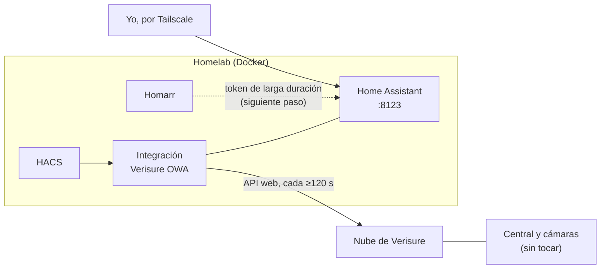

# Domótica: Home Assistant y la alarma de casa

[← Volver al README](../README.md)

Desde el **27 de octubre de 2026**, el homelab tiene **Home Assistant**, y su primera tarea es integrar la **alarma de casa** (Verisure / Securitas Direct): ver su estado, armarla y desarmarla, pedir fotos a las cámaras y consultar el historial, todo desde el homelab y sin depender solo de la app oficial.

> **Privacidad:** esta página explica cómo está montado, no qué hay instalado en casa. No publico capturas del panel de la alarma, fotos de las cámaras ni el detalle de sensores y modos.

## Cómo está montado

| Pieza | Detalle |
|---|---|
| **Home Assistant** | Contenedor con su volumen de configuración. En Windows publicaba el puerto 8123; desde el 31-oct, en el servidor, va con `network_mode: host` para descubrir teles y Chromecast de la red (mDNS) |
| **HACS** | Tienda de integraciones de la comunidad, enlazada con mi cuenta de GitHub |
| **Verisure OWA** | Integración comunitaria (antes *securitas-direct-new-api*) que habla con la misma API web que la app *My Verisure* |

La instalación física de la alarma **no se toca**: la integración usa la misma nube que la app oficial.

### Por qué no la integración oficial

Home Assistant trae una integración "Verisure", pero se conecta a **MyPages**, la plataforma de Verisure en los países nórdicos. Las cuentas de Securitas Direct en España viven en **OWA**, que es lo que usan la app y la web de clientes, así que con la oficial ni siquiera se puede iniciar sesión. Qué plataforma te toca depende del país, no de la alarma.

## Qué permite

- **Alarma:** armar y desarmar, con cada botón de Home Assistant (Casa, Fuera, Noche, Personalizado) asociado a un modo de la central.
- **Cámaras:** fotos bajo demanda en resolución completa. Tardan hasta 30 s, y cada foto queda en el historial de la alarma igual que si se pidiera desde la app.
- **Sensor de ambiente:** temperatura y humedad.
- **Historial de actividad:** armados, desarmados, avisos y fotos, con quién hizo cada cosa. Es lo más útil para automatizar.

Panel propio en Home Assistant con la tarjeta de alarma, una tarjeta por cámara y el historial. La tarjeta de alarma de la integración está **obsoleta** en la versión actual, así que uso el **Panel de alarma** de serie de Home Assistant.

## Limitaciones (de la API, no del montaje)

- **Sin vídeo en directo:** solo fotos.
- **Sin estado de cada puerta o ventana:** la API no lo da; solo se sabe al intentar armar con algo abierto.
- **No se puede forzar el armado** con algo abierto en las centrales españolas.
- **No se puede consultar a menudo:** Verisure bloquea (error 403) a quien pregunta demasiado. El intervalo se queda en **120 s**, el valor por defecto.

## Seguridad

Desde Home Assistant se puede desarmar la alarma de casa, así que lo trato **como si fuera la propia alarma**:

- **Usuario de Verisure solo para Home Assistant**, creado desde la cuenta del titular. En el historial se distingue lo que hace Home Assistant y se le puede quitar el acceso sin tocar ninguna otra cuenta. Los códigos de verificación por SMS llegan a mi móvil.
- **La integración no guarda la contraseña:** la usa una vez para conseguir un token y la descarta.
- **Home Assistant:** contraseña única en KeePassXC y **verificación en dos pasos (TOTP)**.
- **Nunca publicado en internet:** no pasa por Caddy. Desde fuera, solo por [Tailscale](09-acceso-privado-tailscale.md).

## Siguientes pasos

- [ ] **Homarr:** integración con Home Assistant mediante un token de larga duración y widgets con el estado de la alarma y la temperatura. En el servidor, la integración usa la IP de casa del servidor, porque Home Assistant va en la red del host y no en la de Docker.
- [ ] **App de Home Assistant en el móvil** y automatizaciones: aviso de quién ha desarmado, fotos de todas las cámaras si salta un aviso de intrusión y aviso de corte de luz.
- [ ] **Más adelante:** cámaras propias con vídeo local usando **Frigate** y detección con OpenVINO en la gráfica integrada del servidor. Cámaras por cable (PoE) de hasta 5 MP, grabando solo eventos durante 7 días. Antes, ampliar la RAM del servidor a 16 GB.
