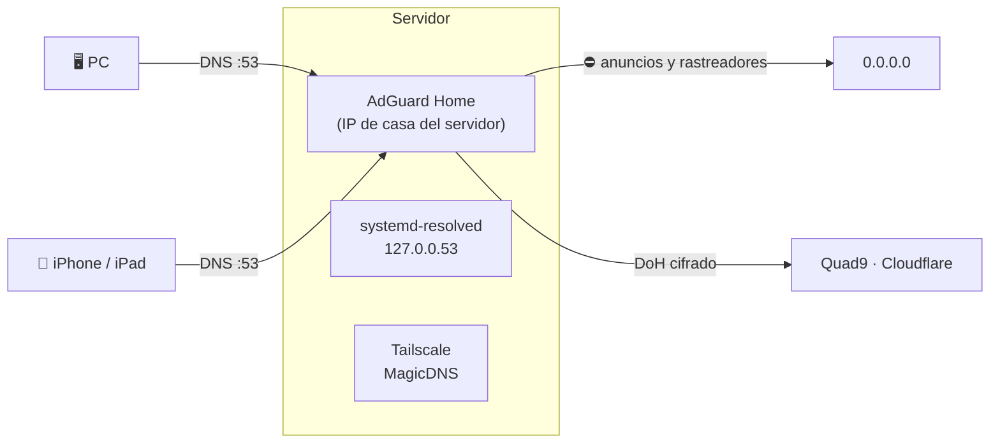

# DNS de la red: AdGuard Home

[← Volver al README](../README.md)

Desde el **31 de octubre de 2026**, el servidor tiene **AdGuard Home**: un DNS propio que bloquea anuncios, rastreadores y dominios maliciosos para todos los aparatos que lo usan, y que resuelve hacia fuera **cifrado** (DNS over HTTPS).

<!-- 📸 Captura del panel de AdGuard Home (sin dominios ni clientes a la vista): images/adguard.png -->

**Por qué AdGuard y no Pi-hole:** bloquean lo mismo con las mismas listas, pero AdGuard trae de serie el DNS cifrado hacia fuera (DoH/DoT) y reglas más flexibles. Además, Homarr tiene un widget para él.

## Cómo está montado

| Ajuste | Valor | Por qué |
|---|---|---|
| Panel web | Puerto **3002** del servidor (3000 dentro del contenedor) | En el asistente inicial, la web se deja en el 3000 interno, no en el 80 |
| DNS | Publicado **solo en la IP de casa del servidor**, puerto 53 TCP/UDP | Ubuntu ya usa el 53 en `127.0.0.53` (systemd-resolved). Así no hay que desactivarlo ni se toca el DNS del propio servidor ni MagicDNS de Tailscale |
| `net.ipv4.ip_nonlocal_bind=1` | En `sysctl` | Para que el contenedor arranque aunque la IP de red llegue un poco después de Docker al encender |
| Servidores de subida | Quad9 y Cloudflare por **DNS over HTTPS**, en paralelo | Consultas cifradas hacia fuera y la respuesta del más rápido |
| Arranque | `9.9.9.9` y `1.1.1.1` | Solo para resolver los nombres de los servidores DoH |
| DNS inverso privado | El router de casa | Para ver nombres de aparatos en lugar de IPs |
| Lista de bloqueo | **HaGeZi Pro** | Buen equilibrio entre bloqueo y pocos falsos positivos. Más adelante, probar Pro++ |

Los volúmenes de AdGuard entran solos en la **copia diaria** de configuraciones, porque la copia recoge todos los volúmenes del proyecto. También está incluido en el kit de mudanza.

**Comprobado:** `nslookup doubleclick.net <IP-del-servidor>` devuelve `0.0.0.0`, es decir, bloqueado.

## El problema: el router del operador

Lo normal sería que el router repartiera AdGuard como DNS a toda la casa por DHCP. **El router del operador no lo permite:** ni el DNS que reparte ni el suyo propio se pueden cambiar ("los configura el operador"). Tampoco parece haber DNS por IPv6 que se salte AdGuard.

Mientras tanto, se configura **aparato por aparato**:

| Aparato | Cómo | Reserva |
|---|---|---|
| PC con Windows | `Set-DnsClientServerAddress`: AdGuard primero y el router de reserva | Sí: si el servidor se apaga, sigue habiendo internet |
| iPhone / iPad | Wi-Fi de casa → Configurar DNS → Manual → solo AdGuard | No: iOS consulta todos los DNS a la vez, así que una reserva se saltaría el bloqueo |

**Para toda la casa** hará falta un router propio detrás del del operador, con AdGuard en el propio router para que internet no dependa del servidor. Es la fase 2 del [plan de seguridad](03-acceso-remoto-y-seguridad.md#plan-de-seguridad-por-fases).

## Limitaciones

- Un bloqueo por DNS **no quita los anuncios de YouTube o Twitch**, ni los que van dentro de las propias apps: se sirven desde los mismos dominios que el contenido.
- Si el servidor se apaga, los aparatos sin DNS de reserva se quedan sin internet hasta que vuelva.

## En Homarr

Integración con `http://adguardhome:3000` (nombre del contenedor y su puerto interno) y widget **DNS Hole** con las consultas y el porcentaje bloqueado.
