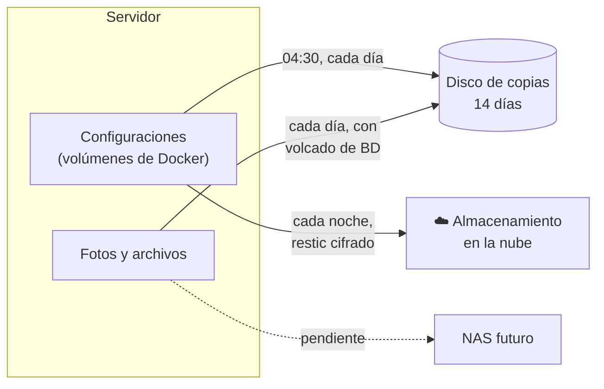

# Copias de seguridad

[← Volver al README](../README.md)

Desde el 31 de octubre y el 1 de noviembre de 2026, el homelab tiene una estrategia de copias por capas: **una copia diaria en otro disco de casa** y **una copia cifrada fuera de casa** de lo que no se puede recuperar de otra forma.

## Qué se copia y qué no

| Qué | Copia en casa (disco de copias) | Copia fuera de casa (cifrada) | Por qué |
|---|---|---|---|
| **Configuraciones** de todos los servicios | ✅ Diaria, 14 días | ✅ Diaria, 7 diarias + 4 semanales | Es lo que más trabajo costaría rehacer |
| **Fotos y archivos** ([Immich y Nextcloud](13-fotos-y-archivos.md)) | ✅ Diaria, con volcado de sus bases de datos y 30 días para lo borrado | Pendiente (cuando haya NAS) | No se pueden volver a conseguir |
| **Biblioteca multimedia** | ❌ | ❌ | Se puede volver a descargar; duplicar cientos de GB no compensa |

Un RAID no estaba en el plan: protege de que se rompa un disco, pero no de borrar algo por error, de que un programa se equivoque o de un ransomware, porque el error se copia al instante en los dos discos. Una copia con historial, sí.

## Copia en casa

- **Configuraciones y volúmenes:** cada día a las 04:30, unos **308 MB**, conservando **14 días**. Recoge sola los volúmenes de cualquier servicio nuevo del proyecto.
- **Al estrenar el disco de copias,** la copia que había en el disco de datos se movió al disco nuevo comprobando con `diff` que era idéntica antes de borrar la original.
- **Primera ejecución automática** sobre el disco nuevo (1-nov): correcta, sin fallos.
- **Fotos y archivos:** scripts diarios con los volcados de sus bases de datos y 30 días de retención para lo borrado. La primera copia de fotos (2,1 GB) salió bien.

## Copia cifrada fuera de casa

**restic** (copias cifradas, deduplicadas y con versiones) sobre **rclone** hacia un almacenamiento en la nube.

| Ajuste | Valor |
|---|---|
| Qué | Configuraciones |
| Cuándo | Cada noche |
| Retención | 7 copias diarias y 4 semanales |
| Verificación | Cada domingo, comprueba una muestra del 5 % de los datos subidos |
| Permisos | **Mínimo privilegio:** rclone solo puede ver los archivos que crea él mismo; el servidor no tiene acceso al resto de la cuenta |

### Lo que costó ponerlo en marcha

- **Autorizar sin navegador.** La autorización de la nube es por OAuth y necesita un navegador; el servidor no tiene, y el equipo que tenía a mano no permitía un túnel SSH. Solución: completar el flujo OAuth a mano, dentro del propio servidor, con `curl`.
- **Un token vacío.** Esta versión de rclone imprime el token en base64, y el comando para extraerlo buscaba JSON. Solución: decodificarlo y escribir la configuración con un script.
- **Espacio.** El plan gratuito se quedaba en unos 450 MB libres. Se amplió a 100 GB y se dejaron de comprimir los archivos antes de subirlos: restic ya comprime y deduplica por su cuenta, y con los archivos sin comprimir solo sube lo que cambia cada día.
- **Límites de la API.** Durante la primera subida aparecieron errores 403 de cuota compartida; restic los reintentó solo y la copia terminó bien.

## El disco de copias: inestable y vigilado

El disco de copias es un HDD viejo de 1 TB en una caja USB. Su salud es buena (44.522 horas, 0 sectores reasignados, 0 pendientes, 0 errores CRC; el contador de no corregibles sigue en 2 y está vigilado), pero **la conexión USB no lo es**.

**La prueba SMART larga se cortaba.** El primer intento se interrumpió al 60 % (*host reset*), sin reinicio ni corte de luz. La causa probable (no demostrada) es que la caja USB apaga el disco por inactividad, porque la prueba interna no genera tráfico por USB. Solución: repetirla leyendo 4 KiB con `O_DIRECT` cada minuto para mantenerlo despierto. `dd iflag=direct` no funcionaba en este sistema, así que la lectura la hace un pequeño script de Python. Resultado: *Completed without error* en unas 2 horas.

**Desconexiones (1-nov, sin resolver).** Dos cortes USB con reconexión inmediata y sin errores previos. Al volver, el disco cambia de nombre de dispositivo y queda desmontado. El peligro es silencioso: **si nadie se da cuenta, las copias caen en el disco de datos**. En el segundo corte el disco sí perdió la corriente, lo que apunta a la alimentación o al adaptador de la caja.

Medidas tomadas:

- `e2fsck` y remontaje: limpios en los dos casos.
- **Beszel apunta al disco por su identificador**, no por su nombre de dispositivo, que cambia en cada reconexión.
- **Vigilancia nueva:** un temporizador de systemd comprueba cada minuto si el disco sigue montado y, si no, avisa al móvil, con un recordatorio cada 6 horas y otro aviso cuando se recupera. La lógica se probó con una simulación; todavía no ha vivido una caída real.
- **Los scripts de copia de fotos y archivos no se ejecutan** si el disco no está montado, para no escribir en el disco equivocado.
- **Pendiente:** probar otro cable, otro puerto u otro alimentador.

## Pendiente

- [ ] Resolver los cortes USB del disco de copias.
- [ ] Comprobar las primeras copias automáticas de fotos, de archivos y de la copia cifrada.
- [ ] Copia fuera de casa de fotos y archivos (con un NAS o ampliando la copia cifrada).
- [ ] Hacer una **restauración de prueba** de la copia cifrada: una copia solo vale si se ha comprobado que se puede recuperar.
