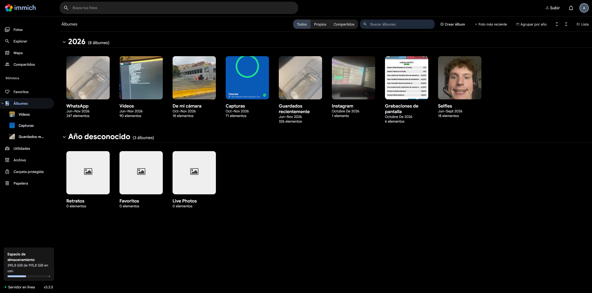
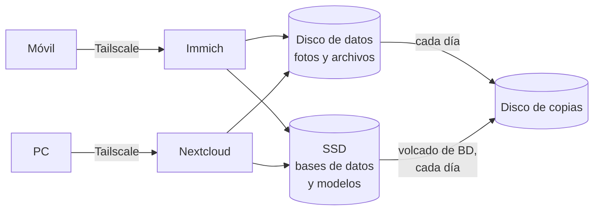

# Fotos y archivos: Immich y Nextcloud

[← Volver al README](../README.md)

Desde el **1 de noviembre de 2026**, el homelab guarda también lo personal: **fotos** con Immich y **archivos** con Nextcloud. Los dos solo se usan por [Tailscale](09-acceso-privado-tailscale.md); ninguno está publicado en internet.

| Servicio | Versión | Para qué | Contenedores |
|---|---|---|---|
| **Immich** | 3.3.5 | Alternativa a Google Fotos: subida automática desde el móvil, línea de tiempo, búsqueda | 4 |
| **Nextcloud** | 34.0.5 | Alternativa a Google Drive: archivos, carpetas compartidas, sincronización | Nextcloud, PostgreSQL y Redis, con las tareas de fondo por cron |

## Diseño del almacenamiento

- **Los datos** (fotos y archivos) van al disco grande.
- **Las bases de datos y los modelos de aprendizaje automático** de Immich van al **SSD**, porque es donde importa la velocidad, y **fuera de los volúmenes de Docker**. Así la copia diaria de configuraciones, que recoge todos los volúmenes, no se infla con varios GB que se pueden regenerar o que ya tienen su propia copia.
- **Copias:** scripts diarios al disco de copias con los volcados de las bases de datos y 30 días de retención para lo borrado. La primera copia de fotos (2,1 GB) salió bien, y la primera automática de la noche (2-nov) copió 8,3 GB sin miniaturas, más el volcado de la base de datos. Ver [Copias de seguridad](12-copias-de-seguridad.md#la-primera-noche-completa-2-nov).
- **Seguridad de las copias:** si el disco de copias no está montado, los scripts no se ejecutan, para no escribir en el disco equivocado.

## Decisiones

- **Las películas y series no tienen copia**, porque se pueden volver a descargar; **las fotos y los archivos sí**, porque no.
- **La copia fuera de casa de fotos y archivos** queda para un NAS futuro. Ampliar el almacenamiento está previsto para el Black Friday, cuando los discos suelen bajar de precio.
- **Solo por Tailscale:** son los datos más personales de todo el homelab.

## En Homarr

Los dos servicios están en la lista de apps con su punto de estado.

## Cifras (2-nov)

| | |
|---|---|
| Fotos | 11 GB |
| Contenedores en total en el servidor, con estos dos servicios | 29 |
